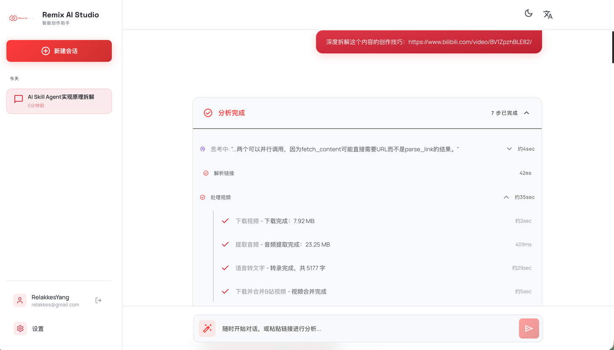
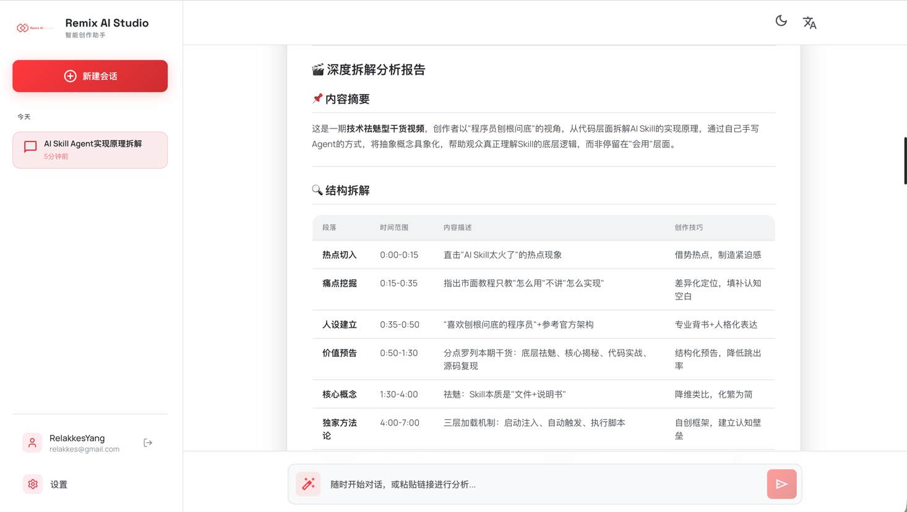
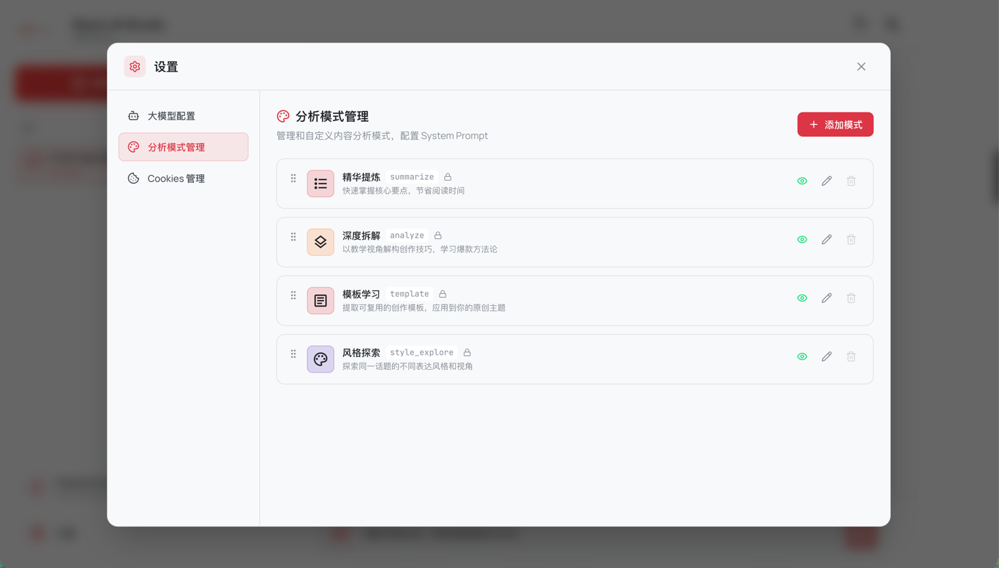
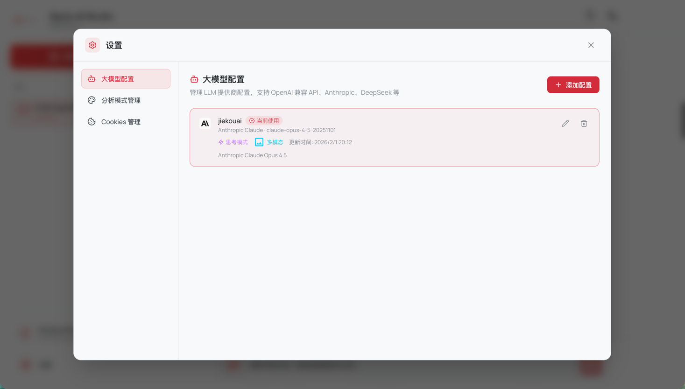

# Content Remix Agent

面向内容创作者的 AI 二创助手。支持小红书/抖音/B站/快手链接解析，自动提取内容、语音转录、结构拆解与灵感生成，并通过 SSE 实时输出结果。

## 快速入口

- [部署指南](docs/deployment/deployment_guide.md)
- [技术架构](docs/architecture/technical_architecture.md)
- [Agent 组件](docs/architecture/agent_components.md)
- [文档索引](docs/README.md)

## 功能概览

- 链接解析与内容抓取（DownloadServer）
- 视频处理与语音转录（FunASR/Bcut）
- LLM 多 Provider（Anthropic/OpenAI 兼容/DeepSeek/Ollama）
- 会话记忆（Checkpointer + Store）
- SSE 流式输出与前端实时渲染

## UI 展示

<table>
  <tr>
    <td></td>
    <td></td>
  </tr>
  <tr>
    <td></td>
    <td></td>
  </tr>
  <tr>
    <td></td>
    <td></td>
  </tr>
</table>

## 运行依赖

- Python 3.10–3.12、`uv`、Node.js + npm、MySQL 8.0+、`ffmpeg`
- [DownloadServer](https://github.com/MediaCrawlerPro/MediaCrawlerPro-Downloader) + [sign-srv](https://github.com/MediaCrawlerPro/MediaCrawlerPro-SignSrv)（需克隆到同一父目录，详见[部署指南](docs/deployment/deployment_guide.md)）

## 本地开发

```bash
cp .env.example .env   # 编辑数据库密码、DOWNLOAD_SERVER_BASE
./start.sh             # 一键启动前后端
```

<details>
<summary>🤖 不想手动装？让 AI Coding Agent 帮你搞定</summary>

将项目目录用 [Claude Code](https://claude.ai/code)、[Cursor](https://cursor.com) 等 AI 编程助手打开，粘贴以下提示词：

```
请帮我安装这个项目的所有依赖并启动开发环境。具体步骤：

1. 阅读项目根目录的 .env.example 和 docs/deployment/deployment_guide.md 了解项目结构
2. 检查本机是否已安装 Python 3.10+、uv、Node.js、MySQL、ffmpeg，缺少的请给出安装命令
3. 复制 .env.example 为 .env，根据本机环境填写数据库连接信息
4. 安装后端依赖（backend 目录，使用 uv sync）
5. 安装前端依赖（frontend 目录，使用 npm install）
6. 尝试运行 ./start.sh 启动项目，如果有报错请帮我修复
```

</details>

<details>
<summary>Windows 用户</summary>

```cmd
copy .env.example .env
start.bat
```

</details>

- 前端：http://localhost:5373 | 后端：http://localhost:8001
- 启动后在前端「设置」页配置 LLM

> 数据库表会在首次启动时自动创建，无需手动建表。

## Docker 部署

> 需先将 [DownloadServer](https://github.com/MediaCrawlerPro/MediaCrawlerPro-Downloader) 和 [sign-srv](https://github.com/MediaCrawlerPro/MediaCrawlerPro-SignSrv) 克隆到同一父目录（Docker Compose 通过相对路径引用）。

```bash
cp .env.example .env           # 编辑 JWT_SECRET_KEY 等必要配置
docker-compose up -d --build
```

- 前端：http://localhost | 后端：http://localhost:8001

## 关键配置

配置文件：`.env`（从 `.env.example` 复制）

| 配置项 | 说明 |
|--------|------|
| `AGENT_DB_*` | MySQL 连接信息 |
| `DOWNLOAD_SERVER_BASE` | DownloadServer 地址 |
| `JWT_SECRET_KEY` | 生产环境必填 |
| **LLM** | 推荐在**前端设置页**配置（数据库持久化），`.env` 仅作兜底 |

> 💡 **大模型 API 推荐**：如果没有官方 API Key，推荐使用 [接口AI](https://jiekou.ai/referral?invited_code=3CF8T0) 作为第三方中转（直接对接官方 API，非逆向），注册绑定 GitHub 可得 3 美元试用券。

## 常见问题

- **DownloadServer 不可用** — 确认 DownloadServer 与 sign-srv 已启动，校验 `DOWNLOAD_SERVER_BASE`
- **转录失败** — FunASR：模型是否下载完成；Bcut：网络是否可达
- **LLM 无法调用** — 前端设置里是否有激活配置，或 `.env` 里是否配置了 provider 与 key

## 文档导航

- [产品说明](docs/product/product_overview.md)
- [后端指南](docs/backend/backend_source_code_guide.md)
- [前端指南](docs/frontend/frontend_source_guide.md)
- [认证配置](docs/auth/auth_configuration.md)
- [设计体系](docs/design/design_system.md)
