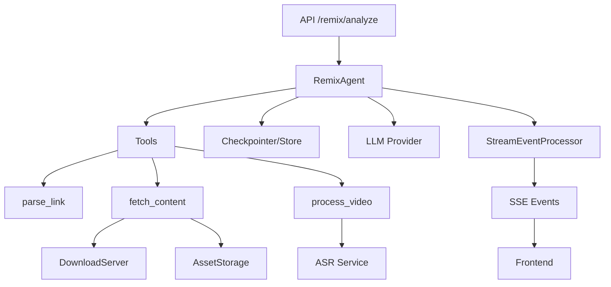
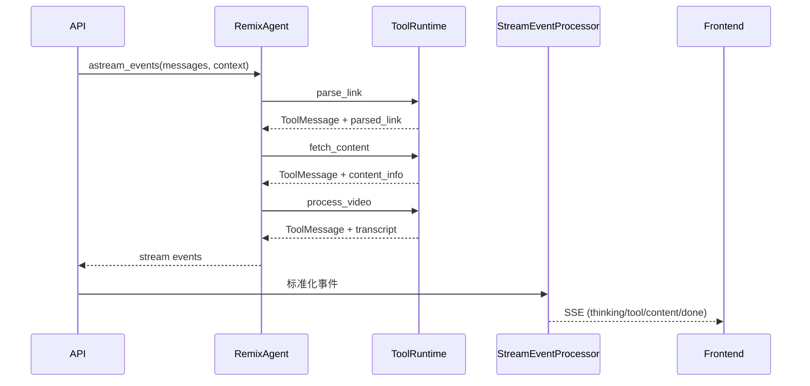

# RemixAgent 技术与组件交互文档

> 目标：说明 RemixAgent 用到的技术、组件以及它们之间的交互方式，便于开发与扩展。

## 1. 技术栈概览

- **LangChain 1.0 + LangGraph**：`create_agent()` 工厂模式、`ToolRuntime`、`Checkpointer/Store`
- **FastAPI + SSE**：`astream_events` → `StreamEventProcessor` → SSE
- **Pydantic v2**：数据模型（`schemas.py`、`agent/state.py`）
- **Loguru**：统一日志
- **MySQL / Memory / Postgres**：可插拔记忆与会话持久化
- **多 LLM Provider**：Anthropic / OpenAI 兼容 / DeepSeek / Ollama
- **ASR**：FunASR 本地 / Bcut 云端

## 2. RemixAgent 组成

### 2.1 Agent 工厂与入口
文件：`content_remix_agent/backend/agent/remix_agent.py`

- `create_remix_agent()`：创建 Agent 实例（每次请求新建）
- `invoke_agent()`：非流式调用
- `stream_agent()`：流式调用（仅供内部）
- `get_agent_state()`：获取最新状态（用于补全 content_info/transcript）

### 2.2 状态与上下文
文件：`content_remix_agent/backend/agent/state.py`

- `RemixAgentState`：Agent 运行状态（parsed_link、content_info、transcript 等）
- `RemixContext`：请求上下文（session_id、mode、instruction、use_mock 等）

### 2.3 中间件链（Middleware）
文件：`content_remix_agent/backend/agent/middleware/*`

执行顺序（在 `create_agent()` 中配置）：
1) `context_compression_middleware`：上下文压缩（防止超窗）
2) `multimodal_injection_middleware`：多模态图片注入
3) `remix_dynamic_prompt`：动态 System Prompt
4) `token_tracking_middleware`：记录 token 使用量

## 3. Agent Tools

### 3.1 parse_link
文件：`agent/tools/link_parser_tool.py`

职责：
- 解析社媒链接（小红书/抖音/B站/快手）
- 生成结构化 `parsed_link` 状态

依赖：
- `services/link_parser.py`

### 3.2 fetch_content
文件：`agent/tools/fetch_content_tool.py`

职责：
- 调用 DownloadServer 拉取内容信息
- 下载封面/图片（可选）
- 写入 `content_info` 状态

依赖：
- `services/download_server_client.py`
- `services/asset_storage.py`
- `services/image_utils.py`

### 3.3 process_video
文件：`agent/tools/video_processor_tool.py`

职责：
- 下载视频/音频
- ffmpeg 提取音频
- ASR 转录（FunASR/Bcut）
- 写入 `transcript` 状态
- 发送子步骤事件（`sub_step_*`）

依赖：
- `services/video_downloader.py`
- `services/audio_extractor.py`
- `services/asr_service.py`
- `services/asset_storage.py`

## 4. 记忆与会话系统

### 4.1 Agent Memory（短期+长期）
文件：`agent/memory/manager.py`

- Checkpointer：短期会话记忆（thread_id）
- Store：长期记忆（namespace + key）
- 存储后端：
  - `memory`：开发环境
  - `mysql`：生产环境（默认推荐）
  - `postgres`：兼容旧配置

### 4.2 会话元数据（Session Manager）
文件：`agent/memory/session.py`

持久化内容：
- session 列表与标题
- 消息内容与 segments
- 关联 user_id（登录用户）

## 5. 流式输出与事件规范

### 5.1 事件处理链
文件：`agent/stream/processor.py` + `agent/stream/emitter.py`

1) `agent.astream_events(...)`
2) `StreamEventProcessor.process_event(...)`
3) `StreamEventEmitter` 标准化事件
4) API 通过 SSE 输出

### 5.2 Reasoning 统一抽取
文件：`agent/stream/reasoning_extractor.py`

适配多 Provider 的推理内容：
- Claude：`content_blocks` (thinking)
- GPT-5：`content_blocks` (reasoning)
- DeepSeek：`reasoning_content`
- MiniMax：`<think>` 标签

### 5.3 标准事件类型（节选）
- `thinking_start` / `thinking_chunk` / `thinking_end`
- `tool_call_start` / `tool_call_finish` / `tool_progress`
- `sub_step_start` / `sub_step_end`
- `content_info` / `transcript`
- `content_chunk` / `done` / `error`

## 6. 组件交互图

## 7. 典型交互时序（工具调用 + SSE）

## 8. 扩展点

- **新增 Tool**：`agent/tools/` 新建工具 → 在 `agent/tools/__init__.py` 导出 → 注册到 `create_remix_agent()`
- **新增 Mode/Prompt**：`services/insight_mode_service.py` + 迁移脚本
- **新增 Provider**：在 `llm_provider.py` 中扩展
- **新增事件**：在 `StreamEventEmitter` 中定义并前后端对齐

