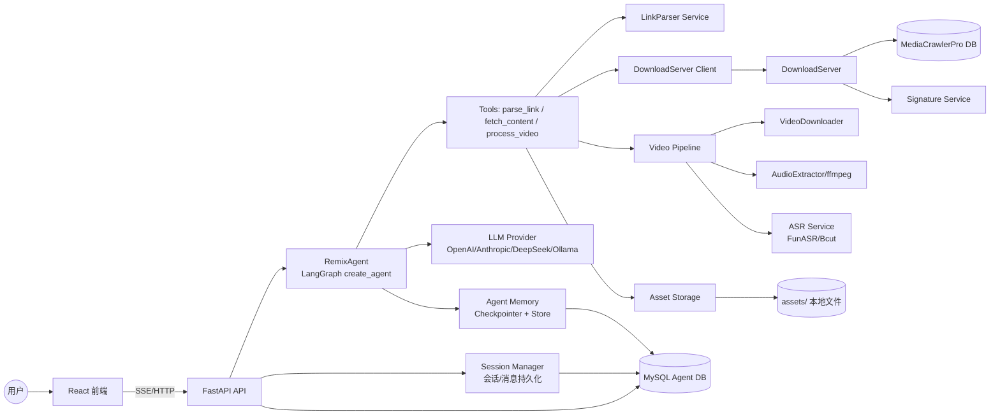
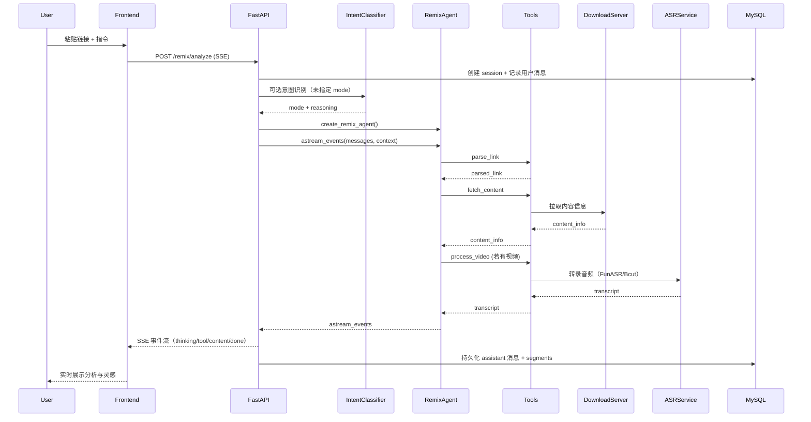
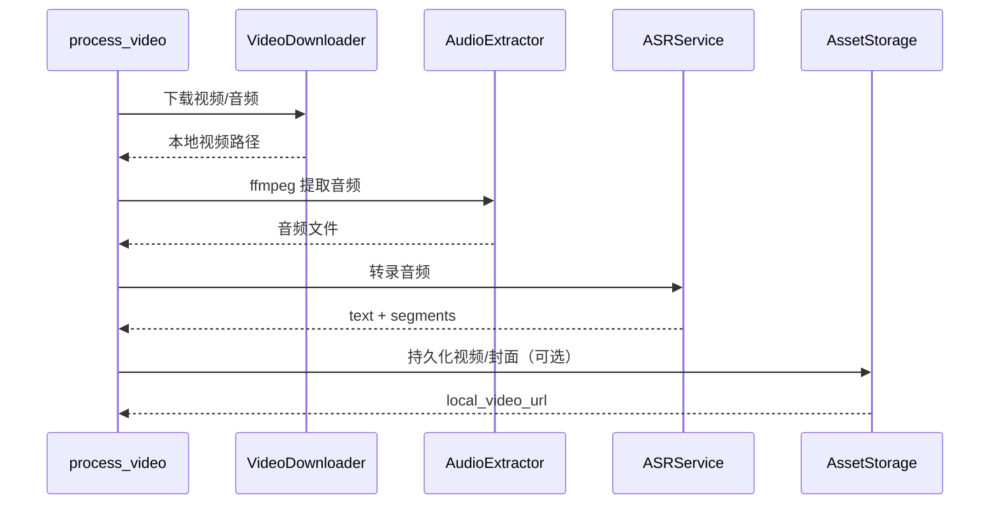
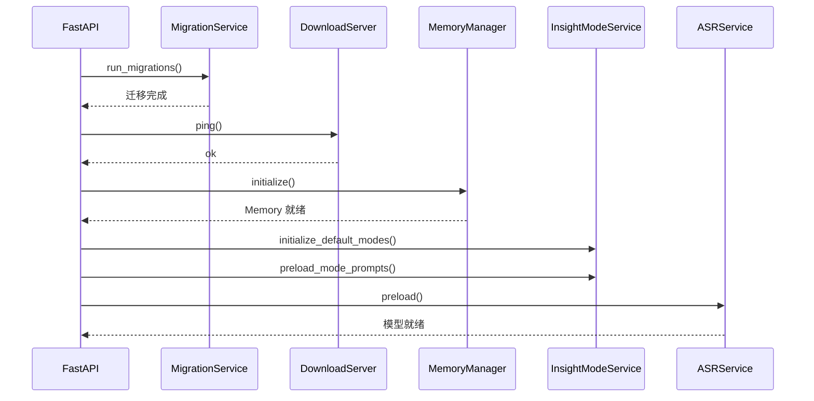
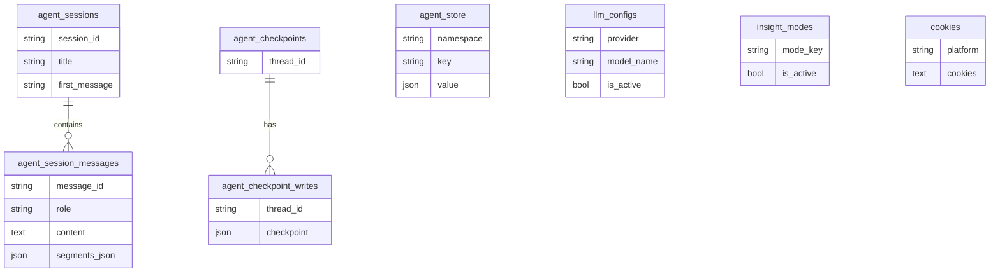

# Content Remix Agent 技术架构文档（最新版）

> 目标：从系统视角说明整体架构、关键组件、数据流与时序，并给出关键流程图/时序图，方便新人快速理解与运维排障。

## 1. 总览

Content Remix Agent 是一个面向内容创作者的 AI 二创系统，核心流程是：
1) 前端提交链接/指令 → 2) 后端创建会话与意图识别 → 3) RemixAgent 调用工具获取内容与转录 → 4) LLM 生成分析与灵感 → 5) SSE 流式返回并持久化。

核心技术栈：
- FastAPI + SSE（sse-starlette）
- LangChain 1.0 + LangGraph create_agent（ToolRuntime + Checkpointer/Store）
- MySQL（会话、Auth、LLM Config、Insight Modes、Agent Memory）
- DownloadServer（内容抓取与下载）
- ASR（FunASR 本地模型 / Bcut 云端 API）
- 资源存储（本地文件系统挂载 /assets）

## 2. 系统架构图

## 3. 关键运行流程（时序）

### 3.1 /api/v1/remix/analyze 主流程（SSE）

### 3.2 视频处理子流程（process_video）

### 3.3 应用启动流程（lifespan）

## 4. 数据与存储结构

### 4.1 数据分类
- **Agent 会话与消息**：session、message、segments（用于前端恢复进度）
- **Agent Memory**：短期 Checkpointer + 长期 Store（跨会话记忆）
- **运行配置**：LLM Config、Insight Modes、Cookies
- **认证系统**：用户、OAuth、刷新令牌、邮件验证
- **静态资源**：封面、视频、合并后的媒体与元数据（本地 assets）

### 4.2 数据库与文件存储关系

> 说明：数据库表结构以 `content_remix_agent/backend/schema/migrations` 为准。文件资源存储在 `content_remix_agent/backend/assets` 并通过 `/assets` 静态路由暴露。

## 5. SSE 事件类型（核心约定）

常见事件：
- `thinking_start` / `thinking_chunk` / `thinking_end`
- `tool_call_start` / `tool_call_finish` / `tool_progress`
- `sub_step_start` / `sub_step_end`（视频处理子步骤）
- `content_info` / `transcript`
- `content_chunk`（最终报告）
- `done` / `error`

事件处理在 `agent/stream/` 内统一封装，前端直接消费标准化事件。

## 6. 关键组件责任边界

- **API 层（api/routes）**：请求校验、会话持久化、SSE 组织与错误处理
- **Agent（agent/）**：策略与推理、工具编排、上下文管理与记忆
- **Services（services/）**：下载、转录、资源存储、LLM 配置、OAuth 等外部依赖封装
- **DB（schema/ + services/migration_service）**：迁移与数据一致性

## 7. 依赖与边界条件

- 必须启动 **DownloadServer**（启动时强依赖 ping 成功）
- MySQL 用于：Agent 数据库 + LLM 配置 + Auth + Insight Modes + Cookies
- ASR 可选：
  - FunASR 本地模型（GPU/CPU）
  - Bcut 云端 API（无需模型下载）
- LLM Provider 通过数据库或 `.env` 选择
