# Content Remix Agent 后端源代码指南

> 本指南帮助开发者快速理解后端项目结构、模块职责和调用流程

## 目录

1. [项目概述](#1-项目概述)
2. [系统架构](#2-系统架构)
3. [目录结构](#3-目录结构)
4. [核心模块详解](#4-核心模块详解)
5. [数据流程](#5-数据流程)
6. [时序图](#6-时序图)
7. [快速上手](#7-快速上手)
8. [关键代码片段](#8-关键代码片段)
9. [扩展开发](#9-扩展开发)

---

## 1. 项目概述

**Content Remix Agent** 是一个基于 LangGraph Agent 的内容二次创作助手。用户粘贴小红书、抖音、B站、快手的视频/图文链接，Agent 自动调用工具提取内容、转录语音、分析结构、生成创意灵感。

### 核心能力

| 能力 | 描述 | 技术实现 |
|------|------|----------|
| 对话式交互 | 自然语言对话驱动工作流 | LangGraph + ReAct Agent |
| 多平台解析 | 支持四大主流平台 | 正则匹配 + DownloadServer API |
| 视频转录 | 语音转文字 | faster-whisper + ffmpeg |
| 内容分析 | 爆款元素识别 | LLM 结构化输出 |
| 灵感生成 | 多模式创意输出 | LLM + 提示工程 |
| 会话记忆 | 对话历史持久化 | MySQL/PostgreSQL Checkpointer |

### 技术栈

```
Runtime:   Python 3.10+
Framework: FastAPI / LangGraph / LangChain 1.0
ASR:       faster-whisper + ffmpeg
Database:  MySQL 5.7+ (业务数据) / MySQL/PostgreSQL (Agent 记忆)
```

---

## 2. 系统架构

### 2.1 整体架构图

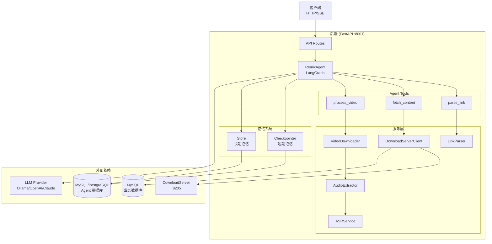

### 2.2 Agent 工作流

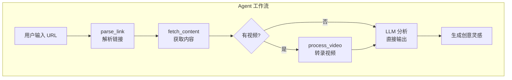

### 2.3 记忆系统架构

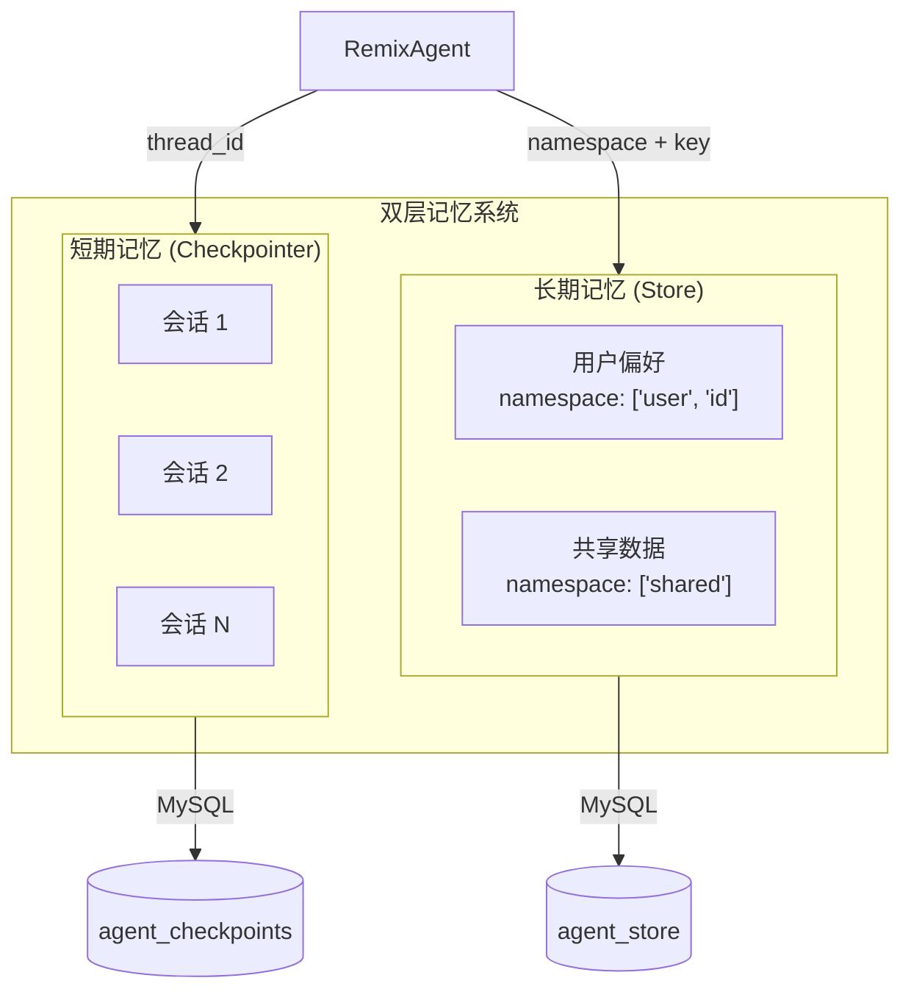

---

## 3. 目录结构

```
content_remix_agent/backend/
├── __init__.py
├── config.py                    # 🔧 全局配置 (Pydantic Settings)
├── schemas.py                   # 📦 数据模型定义
├── llm_provider.py              # 🤖 LLM 提供商抽象
│
├── agent/                       # 🧠 Agent 核心模块
│   ├── __init__.py
│   ├── remix_agent.py           # Agent 工厂和主入口
│   ├── state.py                 # Agent 状态和上下文定义
│   ├── prompts.py               # 系统提示词
│   ├── errors.py                # 统一错误处理
│   ├── middleware.py            # 工具执行中间件
│   │
│   ├── tools/                   # 🔨 Agent 工具集
│   │   ├── link_parser_tool.py
│   │   ├── fetch_content_tool.py
│   │   ├── video_processor_tool.py
│   │   ├── save_analysis_tool.py
│   │   └── save_copywriting_tool.py
│   │
│   ├── memory/                  # 💾 记忆管理
│   │   ├── manager.py           # MemoryManager (初始化/配置)
│   │   └── session.py           # SessionManager (会话元数据)
│   │
│   └── stream/                  # 📡 流式事件处理
│       ├── processor.py         # StreamEventProcessor
│       ├── parser.py            # ThinkingParser (多 Provider)
│       └── emitter.py           # StreamEventEmitter
│
├── api/                         # 🌐 API 层
│   ├── main.py                  # FastAPI 应用入口
│   └── routes/
│       ├── health.py            # 健康检查
│       ├── remix.py             # 核心 API (SSE)
│       └── sse_helpers.py       # SSE 辅助函数
│
├── services/                    # ⚙️ 服务层
│   ├── link_parser.py           # 链接解析
│   ├── download_server_client.py # DownloadServer 客户端
│   ├── video_downloader.py      # 视频下载
│   ├── audio_extractor.py       # 音频提取
│   └── asr_service.py           # ASR 语音识别
│
├── db/                          # 🗄️ 数据库层
│   ├── base.py                  # 连接管理和表初始化
│   ├── mysql_checkpointer.py    # LangGraph Checkpointer 实现
│   ├── mysql_store.py           # LangGraph Store 实现
│   └── utils.py                 # 数据库工具
│
├── utils/                       # 🛠️ 工具函数
│   ├── logger.py                # Loguru 日志配置
│   └── json_utils.py            # JSON 提取和修复
│
├── scripts/                     # 📜 启动脚本
│   ├── run_api_server.py        # API 服务器启动
│   └── test_agent_e2e.py        # 端到端测试
│
├── schema/                      # 📋 数据库 DDL
│   └── agent_ddl.sql
│
├── temp/                        # 临时文件目录
│   └── videos/
│
└── pyproject.toml               # 项目依赖
```

---

## 4. 核心模块详解

### 4.1 配置管理 (`config.py`)

使用 Pydantic Settings 管理所有配置项，支持 `.env` 文件加载。

```python
# 核心配置项
class Settings(BaseSettings):
    # LLM 配置（推荐使用在线 API）
    LLM_PROVIDER: str = "openai"          # openai / anthropic / ollama

    # OpenAI 兼容（推荐，支持 DeepSeek、MiniMax、Moonshot 等）
    OPENAI_BASE_URL: Optional[str] = None
    OPENAI_API_KEY: Optional[str] = None
    OPENAI_MODEL_NAME: Optional[str] = None

    # Anthropic Claude（高质量输出）
    ANTHROPIC_API_KEY: Optional[str] = None
    ANTHROPIC_BASE_URL: Optional[str] = None
    ANTHROPIC_MODEL_NAME: str = "claude-sonnet-4-5-20250929"

    # Ollama 本地模型（仅开发调试）
    OLLAMA_BASE_URL: str = "http://localhost:11434"
    OLLAMA_MODEL_NAME: str = "qwen3:4b"

    # 记忆后端
    MEMORY_BACKEND: str = "memory"        # memory / mysql / postgres
    AGENT_DB_NAME: str = "remix_agent"    # Agent 专用数据库

    # 服务依赖
    DOWNLOAD_SERVER_BASE: str = "http://localhost:8205"
    ASR_DEVICE: str = "cuda:0"            # cuda:0 (GPU) / cpu

    # 开发调试
    USE_MOCK: bool = False
```

### 4.2 Agent 核心 (`agent/remix_agent.py`)

Agent 的创建和调用入口。

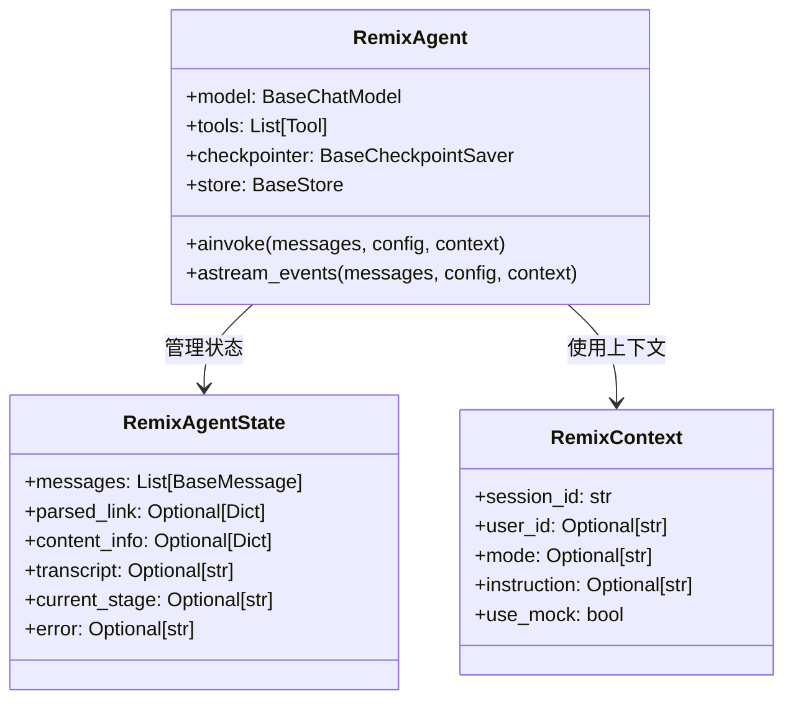

**关键函数：**

| 函数 | 作用 | 使用场景 |
|------|------|----------|
| `create_remix_agent()` | 创建 Agent 实例 | 应用启动时 |
| `get_session_config(session_id)` | 获取会话配置 | 每次请求 |
| `invoke_agent()` | 异步调用 Agent | 一次性请求 |
| `stream_agent()` | 流式调用 Agent | SSE 响应 |
| `get_agent_state()` | 获取当前状态 | 调试/状态查询 |

### 4.3 Agent Tools (`agent/tools/`)

每个 Tool 遵循统一模式：

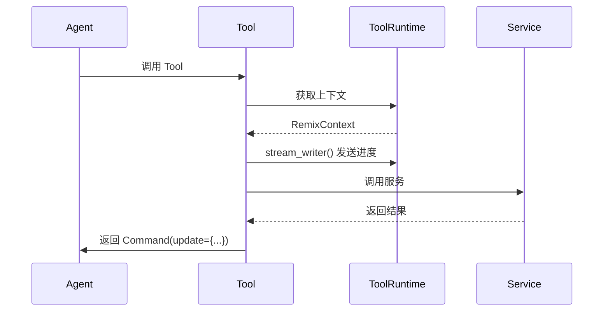

**Tool 模板代码：**

```python
from langchain_core.tools import tool
from langgraph.prebuilt import ToolRuntime
from langgraph.types import Command

@tool
def my_tool(arg: str, runtime: ToolRuntime[RemixContext]) -> Command:
    """Tool 文档说明"""

    # 1. 发送进度更新 (通过 SSE 推送)
    runtime.stream_writer({"stage": "processing", "message": "正在处理..."})

    # 2. 访问上下文
    context = runtime.context
    session_id = context.session_id

    # 3. 调用服务处理
    result = my_service.process(arg)

    # 4. 返回 Command 更新状态
    return Command(update={
        "messages": [ToolMessage(content=result_text, tool_call_id=runtime.tool_call_id)],
        "my_field": result,
        "current_stage": "完成",
    })
```

### 4.4 记忆系统 (`agent/memory/`)

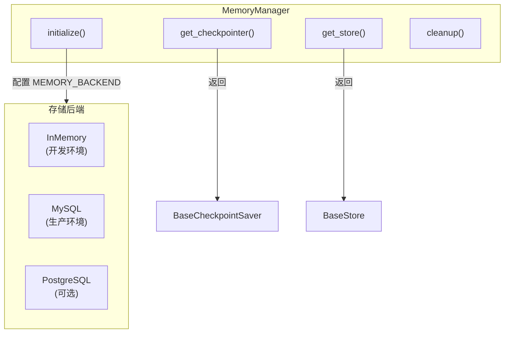

**初始化流程：**

```python
# FastAPI 应用启动时
@asynccontextmanager
async def lifespan(app: FastAPI):
    await memory_manager.initialize()  # 初始化记忆系统
    yield
    await memory_manager.cleanup()     # 清理资源
```

### 4.5 流式处理 (`agent/stream/`)

处理 LangGraph `astream_events` 返回的事件流。

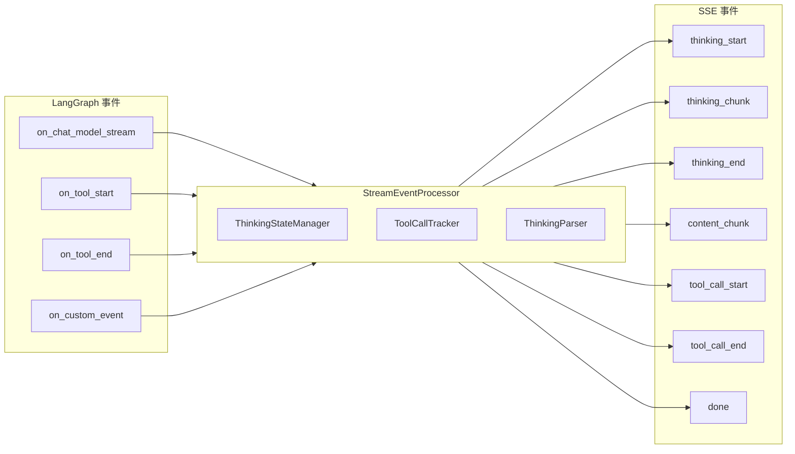

**多 Provider 思考内容解析：**

| Provider | 思考内容位置 | 解析方式 |
|----------|------------|---------|
| Anthropic | `content_blocks[type=thinking]` | 结构化解析 |
| DeepSeek | `additional_kwargs.reasoning_content` | 字段提取 |
| MiniMax | `<think>...</think>` 文本标签 | 正则匹配 |

### 4.6 服务层 (`services/`)

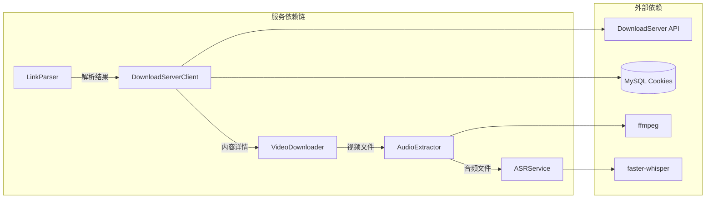

**服务职责：**

| 服务 | 职责 | 输入 | 输出 |
|------|------|------|------|
| `LinkParser` | 解析链接 | URL | `ParsedLink` |
| `DownloadServerClient` | 获取内容详情 | URL | `ContentParseResponse` |
| `VideoDownloader` | 下载视频 | video_url | video_path |
| `AudioExtractor` | 提取音频 | video_path | audio_path |
| `ASRService` | 语音转文字 | audio_path | `TranscriptResult` |

### 4.7 API 层 (`api/`)

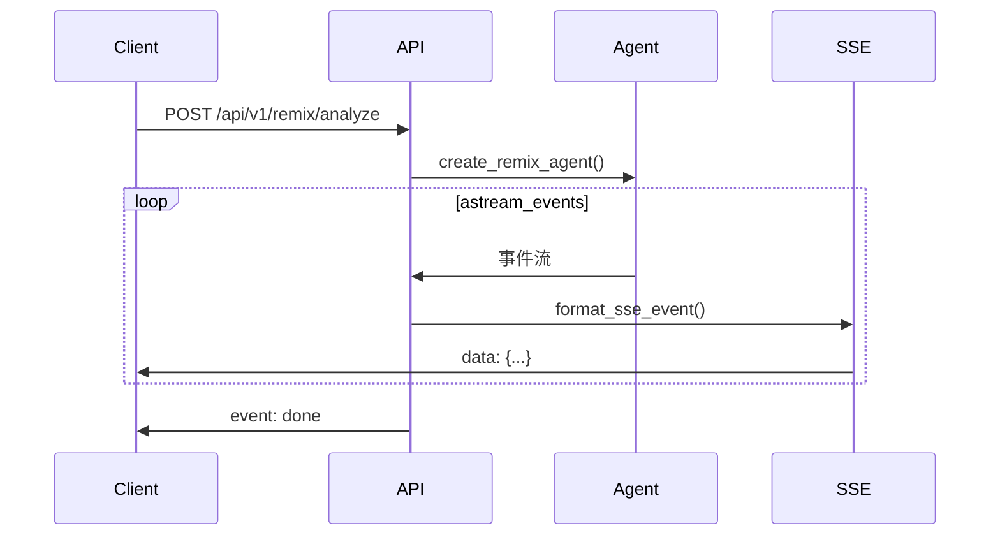

**API 端点：**

| 方法 | 路径 | 功能 | 响应 |
|------|------|------|------|
| `POST` | `/api/v1/remix/analyze` | 分析链接 | SSE |
| `POST` | `/api/v1/remix/chat` | 对话追问 | SSE |
| `GET` | `/api/v1/remix/modes` | 获取模式 | JSON |
| `GET` | `/api/v1/remix/session/{id}` | 获取会话 | JSON |
| `GET` | `/api/v1/remix/sessions` | 会话列表 | JSON |
| `DELETE` | `/api/v1/remix/session/{id}` | 删除会话 | JSON |

### 4.8 数据库层 (`db/`)

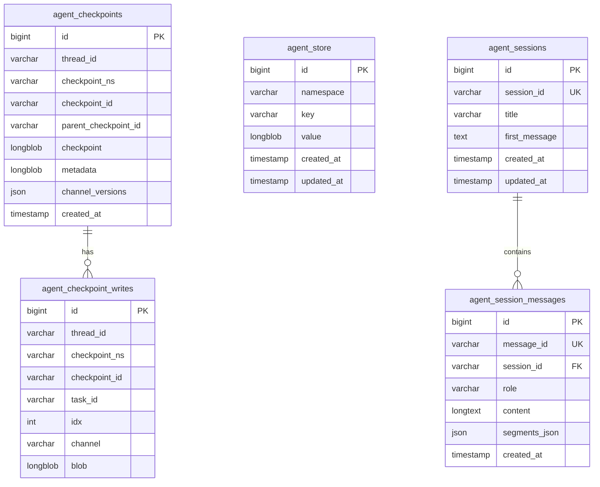

---

## 5. 数据流程

### 5.1 完整处理流程

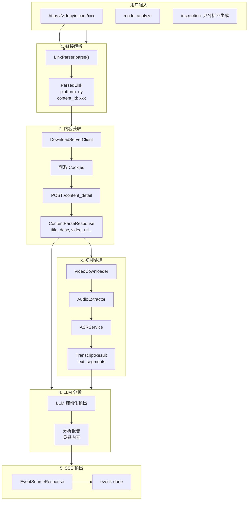

### 5.2 SSE 事件流

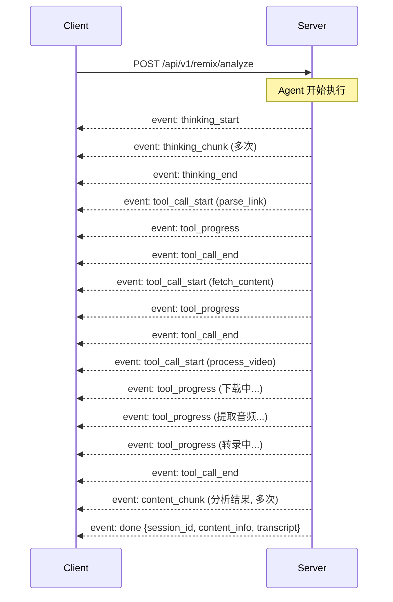

---

## 6. 时序图

### 6.1 应用启动流程

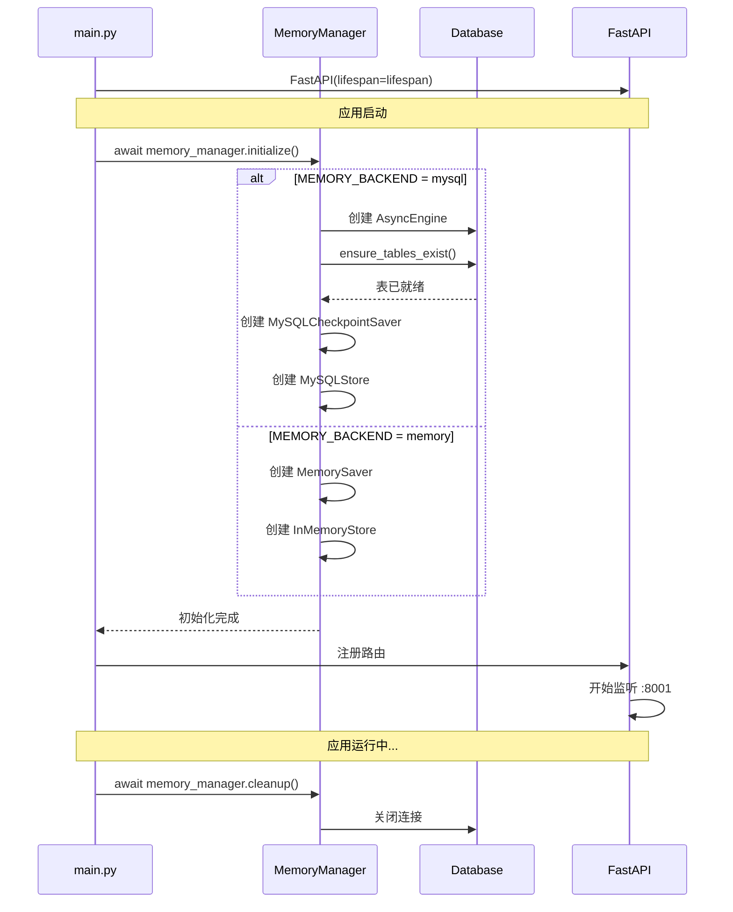

### 6.2 分析请求处理流程

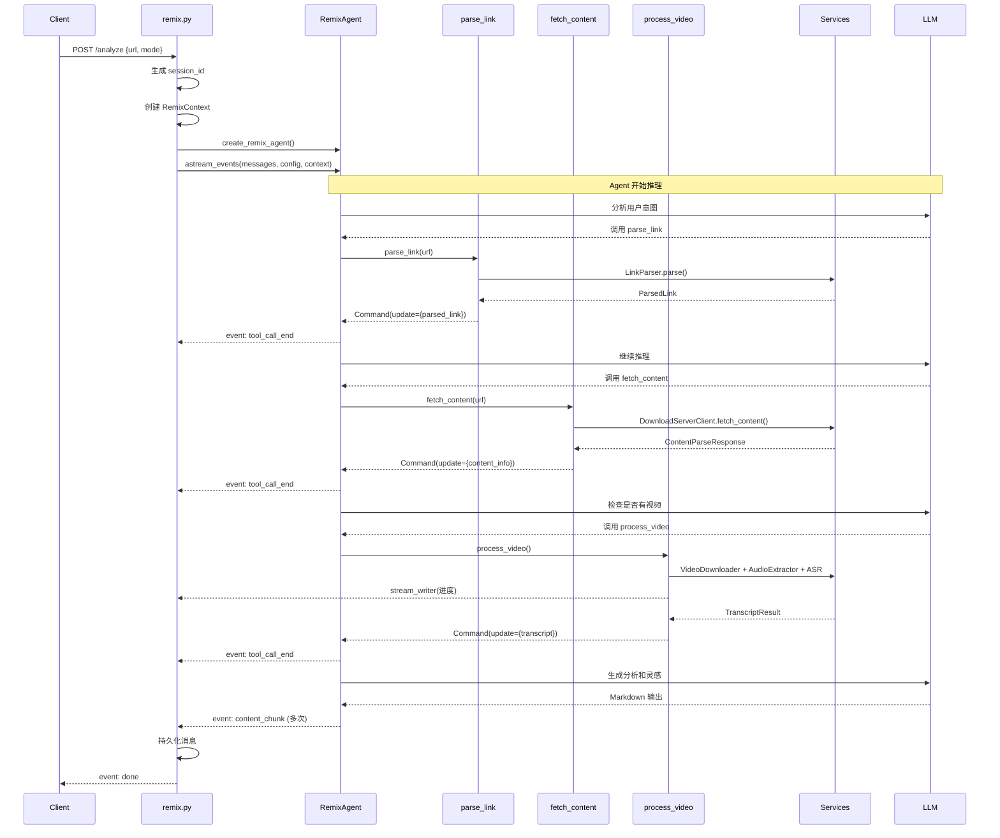

### 6.3 对话追问流程

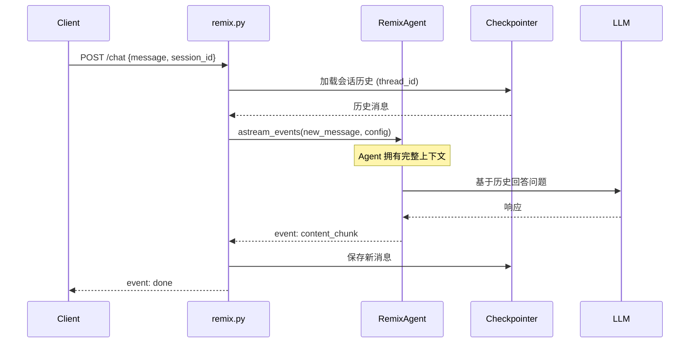

---

## 7. 快速上手

### 7.1 环境准备

```bash
# 1. 进入项目目录
cd content_remix_agent/backend

# 2. 安装依赖
uv sync

# 3. 安装 ASR 依赖（faster-whisper，首次运行会自动下载模型）
uv add faster-whisper

# 4. 安装 PostgreSQL 依赖（可选，用于会话持久化）
uv sync --extra postgres

# 5. 安装 ffmpeg（macOS）
brew install ffmpeg

# 6. 配置在线 LLM API（推荐）
# 编辑 .env 文件配置 API Key，见下方配置示例
```

### 7.2 配置文件

创建 `backend/.env`：

```ini
# ========== LLM 配置（推荐使用在线 API）==========

# 方式一：OpenAI 兼容 API（推荐，支持 DeepSeek、MiniMax、Moonshot 等）
LLM_PROVIDER=openai
OPENAI_BASE_URL=https://api.minimaxi.com/v1
OPENAI_API_KEY=your_api_key
OPENAI_MODEL_NAME=MiniMax-M2.1-lightning

# 方式二：Anthropic Claude（推荐用于高质量输出）
# LLM_PROVIDER=anthropic
# ANTHROPIC_API_KEY=your_api_key
# ANTHROPIC_BASE_URL=https://api.anthropic.com  # 或自定义代理
# ANTHROPIC_MODEL_NAME=claude-sonnet-4-5-20250929

# 方式三：Ollama 本地模型（仅开发调试）
# LLM_PROVIDER=ollama
# OLLAMA_BASE_URL=http://localhost:11434
# OLLAMA_MODEL_NAME=qwen3:4b

# ========== 业务数据库（MediaCrawlerPro）==========
DB_HOST=localhost
DB_PORT=3306
DB_USER=root
DB_PASSWORD=your_password
DB_NAME=media_crawler_pro

# ========== Agent 记忆数据库 ==========
MEMORY_BACKEND=mysql  # memory / mysql / postgres
AGENT_DB_HOST=localhost
AGENT_DB_PORT=3306
AGENT_DB_USER=root
AGENT_DB_PASSWORD=
AGENT_DB_NAME=remix_agent

# ========== DownloadServer ==========
DOWNLOAD_SERVER_BASE=http://localhost:8205
DOWNLOAD_SERVER_TIMEOUT=60

# ========== ASR ==========
ASR_DEVICE=cuda:0  # cuda:0 (GPU) 或 cpu

# ========== API ==========
API_HOST=0.0.0.0
API_PORT=8001

# ========== 开发 ==========
USE_MOCK=false
LOG_LEVEL=INFO
```

### 7.3 启动服务

```bash
# 启动 API 服务器
uv run python scripts/run_api_server.py

# 开发模式（自动重载）
uv run python scripts/run_api_server.py --reload
```

### 7.4 测试请求

```bash
# 健康检查
curl http://localhost:8001/health

# 分析请求（SSE）
curl -N -X POST http://localhost:8001/api/v1/remix/analyze \
  -H "Content-Type: application/json" \
  -d '{"url": "https://v.douyin.com/xxx", "mode": "analyze"}'

# 获取模式列表
curl http://localhost:8001/api/v1/remix/modes
```

### 7.5 端到端测试

```bash
# 运行完整测试
uv run python scripts/test_agent_e2e.py
```

---

## 8. 关键代码片段

### 8.1 创建 Agent

```python
# agent/remix_agent.py
from langgraph.prebuilt import create_agent
from langchain_core.messages import HumanMessage

def create_remix_agent():
    """创建 RemixAgent 实例"""
    model = get_model()  # LLM

    tools = [
        parse_link,        # 解析链接
        fetch_content,     # 获取内容
        process_video,     # 处理视频
    ]

    agent = create_agent(
        model=model,
        tools=tools,
        system_prompt=REMIX_AGENT_SYSTEM_PROMPT,
        state_schema=RemixAgentState,
        context_schema=RemixContext,
        checkpointer=get_checkpointer(),
        store=get_store(),
    )

    return agent
```

### 8.2 调用 Agent

```python
# 异步调用
async def invoke_agent(agent, message: str, session_id: str, context: RemixContext):
    config = get_session_config(session_id)
    result = await agent.ainvoke(
        {"messages": [HumanMessage(content=message)]},
        config=config,
        context=context,
    )
    return result

# 流式调用
async def stream_agent(agent, message: str, session_id: str, context: RemixContext):
    config = get_session_config(session_id)
    async for event in agent.astream_events(
        {"messages": [HumanMessage(content=message)]},
        config=config,
        context=context,
        version="v2",
    ):
        yield event
```

### 8.3 定义 Tool

```python
# agent/tools/link_parser_tool.py
from langchain_core.tools import tool
from langgraph.prebuilt import ToolRuntime
from langgraph.types import Command

@tool
def parse_link(url: str, runtime: ToolRuntime[RemixContext]) -> Command:
    """解析社交媒体链接，识别平台和内容 ID"""

    # 发送进度
    runtime.stream_writer({
        "stage": "parsing",
        "message": "正在解析链接...",
    })

    # 调用服务
    parser = LinkParser()
    result = parser.parse(url)

    if result is None:
        raise RemixToolException(
            RemixErrorCode.INVALID_URL,
            f"无法识别的链接格式: {url}",
        )

    # 返回状态更新
    return Command(update={
        "messages": [ToolMessage(
            content=f"链接解析成功: {result.platform}",
            tool_call_id=runtime.tool_call_id,
        )],
        "parsed_link": result.model_dump(),
        "current_stage": "链接解析完成",
    })
```

### 8.4 SSE 事件处理

```python
# api/routes/remix.py
from sse_starlette.sse import EventSourceResponse

@router.post("/analyze")
async def analyze(request: AnalyzeRequest):
    session_id = request.session_id or str(uuid.uuid4())

    async def event_generator():
        agent = create_remix_agent()
        processor = StreamEventProcessor()

        context = RemixContext(
            session_id=session_id,
            mode=request.mode.value if request.mode else None,
            instruction=request.instruction,
            use_mock=settings.USE_MOCK,
        )

        config = get_session_config(session_id)
        messages = [HumanMessage(content=user_message)]

        try:
            async for event in agent.astream_events(
                {"messages": messages},
                config=config,
                context=context,
                version="v2",
            ):
                for output in processor.process_event(event):
                    yield format_sse_event(output["type"], output["data"])

            # 完成事件
            yield format_sse_event("done", {
                "session_id": session_id,
                "content_info": final_state.get("content_info"),
            })

        except Exception as e:
            yield format_sse_event("error", {
                "code": "AGENT_ERROR",
                "message": str(e),
            })

    return EventSourceResponse(event_generator())
```

### 8.5 获取 LLM

```python
# llm_provider.py
from langchain_anthropic import ChatAnthropic
from langchain_openai import ChatOpenAI
from langchain_ollama import ChatOllama

def get_llm(temperature: float = 0.1) -> BaseChatModel:
    """根据配置返回 LLM 实例"""
    provider = settings.LLM_PROVIDER.lower()

    if provider == "anthropic":
        return ChatAnthropic(
            model=settings.ANTHROPIC_MODEL_NAME,
            api_key=settings.ANTHROPIC_API_KEY,
            temperature=temperature,
        )
    elif provider == "openai":
        return ChatOpenAI(
            model=settings.OPENAI_MODEL_NAME,
            api_key=settings.OPENAI_API_KEY,
            base_url=settings.OPENAI_BASE_URL,
            temperature=temperature,
        )
    elif provider == "ollama":
        return ChatOllama(
            model=settings.OLLAMA_MODEL_NAME,
            base_url=settings.OLLAMA_BASE_URL,
            temperature=temperature,
        )
    else:
        raise ValueError(f"Unsupported provider: {provider}")
```

### 8.6 数据库初始化

```python
# db/base.py
async def ensure_tables_exist(engine: AsyncEngine) -> bool:
    """创建 Agent 记忆存储表"""
    ddl_statements = [
        # agent_checkpoints
        """CREATE TABLE IF NOT EXISTS agent_checkpoints (
            id BIGINT UNSIGNED AUTO_INCREMENT PRIMARY KEY,
            thread_id VARCHAR(255) NOT NULL,
            checkpoint_id VARCHAR(255) NOT NULL,
            checkpoint LONGBLOB NOT NULL,
            ...
        )""",
        # agent_store
        """CREATE TABLE IF NOT EXISTS agent_store (
            id BIGINT UNSIGNED AUTO_INCREMENT PRIMARY KEY,
            namespace VARCHAR(1024) NOT NULL,
            `key` VARCHAR(255) NOT NULL,
            value LONGBLOB NOT NULL,
            ...
        )""",
        # ... 更多表
    ]

    async with engine.begin() as conn:
        for ddl in ddl_statements:
            await conn.execute(text(ddl))

    return True
```

---

## 9. 扩展开发

### 9.1 添加新工具

1. 创建工具文件 `agent/tools/my_new_tool.py`：

```python
from langchain_core.tools import tool
from langgraph.prebuilt import ToolRuntime
from langgraph.types import Command

@tool
def my_new_tool(arg: str, runtime: ToolRuntime[RemixContext]) -> Command:
    """工具描述 - Agent 根据此决定何时调用"""

    # 发送进度
    runtime.stream_writer({"stage": "processing", "message": "处理中..."})

    # 处理逻辑
    result = do_something(arg)

    # 返回状态更新
    return Command(update={
        "messages": [ToolMessage(content=str(result), tool_call_id=runtime.tool_call_id)],
        "my_field": result,
    })
```

2. 导出工具 `agent/tools/__init__.py`：

```python
from agent.tools.my_new_tool import my_new_tool

__all__ = [..., "my_new_tool"]
```

3. 注册到 Agent `agent/remix_agent.py`：

```python
tools = [
    parse_link,
    fetch_content,
    process_video,
    my_new_tool,  # 新增
]
```

### 9.2 添加新的 LLM Provider

修改 `llm_provider.py`：

```python
def get_llm(temperature: float = 0.1) -> BaseChatModel:
    provider = settings.LLM_PROVIDER.lower()

    # ... 现有 provider

    elif provider == "my_provider":
        from my_llm_package import ChatMyProvider
        return ChatMyProvider(
            model=settings.MY_PROVIDER_MODEL_NAME,
            api_key=settings.MY_PROVIDER_API_KEY,
            temperature=temperature,
        )
```

### 9.3 添加新的存储后端

修改 `agent/memory/manager.py`：

```python
async def initialize(self) -> None:
    backend = settings.MEMORY_BACKEND

    if backend == "my_backend":
        await self._init_my_backend()
    # ... 现有后端

async def _init_my_backend(self) -> None:
    from my_backend import MyCheckpointSaver, MyStore
    self._checkpointer = MyCheckpointSaver(...)
    self._store = MyStore(...)
```

### 9.4 添加新平台支持

修改 `services/link_parser.py`：

```python
class Platform(str, Enum):
    # 现有平台
    XHS = "xhs"
    DOUYIN = "dy"
    # 新平台
    WEIBO = "weibo"

PLATFORM_DOMAINS = {
    # 现有映射
    "weibo.com": Platform.WEIBO,
    "m.weibo.cn": Platform.WEIBO,
}

CONTENT_ID_PATTERNS = {
    # 现有模式
    Platform.WEIBO: [
        r"/status/(\d+)",
        r"/detail/(\d+)",
    ],
}
```

### 9.5 自定义 Agent 状态

修改 `agent/state.py`：

```python
class RemixAgentState(AgentState):
    """Agent 状态定义"""

    # 现有字段
    parsed_link: Optional[ParsedLinkDict]
    content_info: Optional[ContentInfoDict]
    transcript: Optional[str]

    # 新增字段
    my_custom_field: Optional[MyCustomDict]
    another_field: Annotated[Optional[str], last_value]
```

---

## 附录

### A. 错误码对照表

| 错误码 | 描述 | 处理建议 |
|--------|------|----------|
| `INVALID_URL` | 无法识别的链接格式 | 检查链接是否为支持的平台 |
| `CONTENT_NOT_FOUND` | 内容不存在或已删除 | 确认链接有效 |
| `COOKIES_NOT_FOUND` | 未找到平台 Cookies | 检查 DownloadServer 配置 |
| `DOWNLOAD_FAILED` | 视频下载失败 | 检查网络和视频链接 |
| `ASR_FAILED` | 语音转录失败 | 检查音频格式和 ASR 服务 |
| `ANALYSIS_FAILED` | 内容分析失败 | 检查 LLM 配置 |
| `AGENT_ERROR` | Agent 执行错误 | 查看详细日志 |

### B. 配置项速查表

| 配置项 | 推荐值 | 描述 |
|--------|--------|------|
| `LLM_PROVIDER` | `openai` | LLM 提供商 (openai/anthropic/ollama) |
| `OPENAI_BASE_URL` | - | OpenAI 兼容 API 地址 |
| `OPENAI_MODEL_NAME` | - | 模型名称 (如 MiniMax-M2.1-lightning) |
| `MEMORY_BACKEND` | `mysql` | 记忆存储后端 (memory/mysql/postgres) |
| `USE_MOCK` | `false` | Mock 模式（开发调试用） |
| `API_PORT` | `8001` | API 端口 |
| `ASR_DEVICE` | `cuda:0` | ASR 设备 (cuda:0/cpu) |
| `VIDEO_DOWNLOAD_TIMEOUT` | `120` | 下载超时(秒) |
| `AGENT_MAX_ITERATIONS` | `10` | Agent 最大迭代 |

### C. 相关文档

- [LangGraph 官方文档](https://langchain-ai.github.io/langgraph/)
- [LangChain 1.0 迁移指南](https://python.langchain.com/docs/versions/migrating_chains/)
- [FastAPI 文档](https://fastapi.tiangolo.com/)
- [faster-whisper 文档](https://github.com/SYSTRAN/faster-whisper)

---

*最后更新: 2025-01-17*
