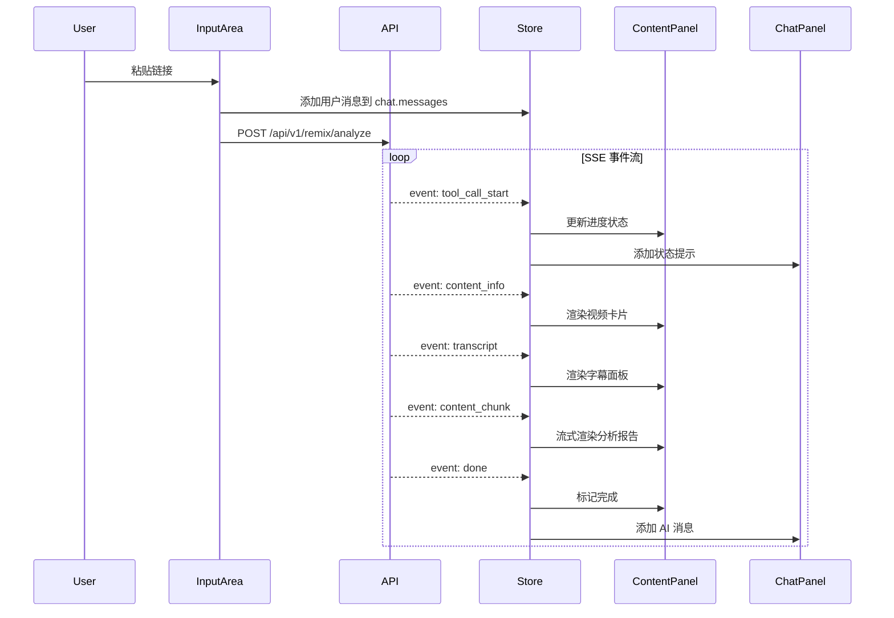

# Content Remix Agent UI 设计文档 V2

> 本文档描述前端 UI 重构方案，从「对话为中心」转向「内容展示为中心 + 对话辅助」的三栏布局设计。

## 目录

1. [当前设计分析](#1-当前设计分析)
2. [新设计目标](#2-新设计目标)
3. [布局架构](#3-布局架构)
4. [模块详解](#4-模块详解)
5. [数据流设计](#5-数据流设计)
6. [交互流程](#6-交互流程)
7. [组件规划](#7-组件规划)
8. [样式系统](#8-样式系统)

---

## 1. 当前设计分析

### 1.1 当前布局结构

```
┌─────────────────────────────────────────────────────────────────┐
│                          Header                                  │
├──────────┬──────────────────────────────────────────────────────┤
│          │                                                       │
│ Sidebar  │              ChatContainer                            │
│ (会话列表) │              (对话消息流)                              │
│          │                                                       │
│  - 历史会话 │  ┌─────────────────────────────────────────────┐    │
│  - 新建会话 │  │ [User] 分析这个链接 https://...              │    │
│          │  │                                                │    │
│          │  │ [AI] 🔍 正在解析链接...                        │    │
│          │  │      ✓ 解析完成                                │    │
│          │  │      📹 正在转录视频...                        │    │
│          │  │                                                │    │
│          │  │ [VideoCard] 视频预览卡片                       │    │
│          │  │                                                │    │
│          │  │ [AI] ## 内容分析报告                           │    │
│          │  │      ### 爆款元素                              │    │
│          │  │      ...                                       │    │
│          │  └─────────────────────────────────────────────┘    │
│          │                                                       │
│          │  ┌─────────────────────────────────────────────┐    │
│          │  │ InputArea (输入框 + 快捷操作)                  │    │
│          │  └─────────────────────────────────────────────┘    │
└──────────┴──────────────────────────────────────────────────────┘
```

### 1.2 当前设计的问题

| 问题 | 描述 |
|------|------|
| **信息混杂** | 视频卡片、字幕、分析报告、对话消息混在一起，难以聚焦 |
| **内容不突出** | 用户最关心的分析结果被对话消息淹没 |
| **复用困难** | 每次想看分析结果，需要在对话流中上下滚动寻找 |
| **空间利用低** | 宽屏显示器下，中间区域过宽，两侧留白 |

### 1.3 当前组件结构

```
App.jsx
├── Header.jsx              # 顶部导航
├── Sidebar/                # 左侧会话列表
│   ├── SessionList.jsx
│   └── SessionItem.jsx
├── ChatContainer.jsx       # 中间对话区（核心）
│   ├── QuickActions.jsx    # 快捷操作按钮
│   ├── MessageItem.jsx     # 消息渲染器
│   │   ├── UserMessage.jsx
│   │   └── AIMessage.jsx
│   │       ├── VideoCard.jsx
│   │       ├── StepsCollapsible.jsx
│   │       ├── MarkdownBlock.jsx
│   │       └── ThinkingBlock.jsx
└── InputArea.jsx           # 底部输入框
```

---

## 2. 新设计目标

### 2.1 设计理念

**从「对话为中心」转向「内容展示为中心 + 对话辅助」**

- 用户的核心诉求是**获取分析结果**，而非**进行对话**
- 对话是达成目标的**手段**，分析结果才是**目的**
- 新设计将分析结果「前置」，对话「侧边化」

### 2.2 设计目标

| 目标 | 描述 |
|------|------|
| **内容聚焦** | 中央区域专注展示分析结果，一目了然 |
| **信息分层** | 视频元信息、字幕、分析报告分块展示 |
| **对话辅助** | 右侧对话区用于追问、调整、二次创作 |
| **高效复用** | 分析结果持久展示，随时参考 |

### 2.3 目标用户场景

```
场景 1: 首次分析
用户粘贴链接 → 中央显示视频卡片 + 字幕 + 分析报告 → 右侧显示对话记录

场景 2: 追问调整
用户在右侧输入「换个更吸引人的标题」→ AI 回复在右侧 → 中央可选择性更新

场景 3: 切换会话
用户在左侧点击历史会话 → 中央恢复该会话的分析结果 → 右侧恢复对话历史
```

---

## 3. 布局架构

### 3.1 新布局结构（三栏布局）

```
┌─────────────────────────────────────────────────────────────────────────────┐
│                                Header                                        │
├─────────┬───────────────────────────────────────────────────┬───────────────┤
│         │                                                   │               │
│ Sidebar │              ContentPanel                         │  ChatPanel    │
│ (会话列表) │              (内容展示区)                          │  (对话区)      │
│         │                                                   │               │
│ 240px   │              flex-1 (自适应)                        │   360px       │
│ 可折叠   │                                                   │   可折叠       │
│         │  ┌─────────────────────────────────────────────┐  │               │
│ ┌─────┐ │  │         VideoInfoCard                       │  │ ┌───────────┐│
│ │新建  │ │  │  封面 | 标题 | 作者 | 数据                    │  │ │ 对话消息   ││
│ └─────┘ │  └─────────────────────────────────────────────┘  │ │           ││
│         │                                                   │ │ [User]    ││
│ ┌─────┐ │  ┌─────────────────────────────────────────────┐  │ │ 分析这个   ││
│ │会话1 │ │  │         TranscriptPanel                     │  │ │           ││
│ └─────┘ │  │  视频字幕 / 语音转文字                         │  │ │ [AI]      ││
│ ┌─────┐ │  │  可折叠 | 时间戳 | 全文搜索                    │  │ │ 好的...   ││
│ │会话2 │ │  └─────────────────────────────────────────────┘  │ │           ││
│ └─────┘ │                                                   │ │           ││
│         │  ┌─────────────────────────────────────────────┐  │ └───────────┘│
│ ┌─────┐ │  │         AnalysisPanel                       │  │               │
│ │会话3 │ │  │  AI 分析报告 (Markdown)                      │  │ ┌───────────┐│
│ └─────┘ │  │  - 内容概要                                  │  │ │ 输入框    ││
│         │  │  - 结构拆解                                  │  │ │           ││
│         │  │  - 爆款元素                                  │  │ └───────────┘│
│         │  │  - 创意灵感                                  │  │               │
│         │  └─────────────────────────────────────────────┘  │               │
│         │                                                   │               │
└─────────┴───────────────────────────────────────────────────┴───────────────┘
```

### 3.2 响应式布局

| 屏幕宽度 | 布局方案 |
|---------|---------|
| `≥ 1440px` | 三栏布局（Sidebar 240px + Content flex-1 + Chat 360px） |
| `1024px - 1439px` | 三栏布局（Sidebar 折叠 + Content flex-1 + Chat 320px） |
| `768px - 1023px` | 两栏布局（Content + Chat，Sidebar 抽屉） |
| `< 768px` | 单栏布局（Tab 切换：内容 / 对话） |

### 3.3 栏宽配置

```javascript
const LAYOUT_CONFIG = {
  sidebar: {
    width: 240,
    minWidth: 200,
    maxWidth: 320,
    collapsedWidth: 64,  // 折叠后只显示图标
  },
  chatPanel: {
    width: 360,
    minWidth: 280,
    maxWidth: 480,
    collapsedWidth: 0,   // 完全隐藏
  },
  contentPanel: {
    minWidth: 480,       // 最小宽度
  }
}
```

---

## 4. 模块详解

### 4.1 左侧 - Sidebar（会话列表）

**职责**: 管理历史会话，快速切换

```
┌─────────────────────────┐
│  [+] 新建分析            │  ← 主操作按钮
├─────────────────────────┤
│  🔍 搜索会话...          │  ← 搜索框
├─────────────────────────┤
│  今天                    │  ← 时间分组
│  ├─ 📹 抖音职场效率视频   │
│  └─ 📷 小红书护肤教程     │
│                         │
│  昨天                    │
│  ├─ 📹 B站编程教学       │
│  └─ 📹 快手美食制作       │
│                         │
│  更早                    │
│  └─ ...                 │
└─────────────────────────┘
```

**交互**:
- 点击会话 → 中央和右侧同时加载该会话数据
- 右键会话 → 上下文菜单（重命名、删除、导出）
- 拖拽排序 → 置顶重要会话

### 4.2 中央 - ContentPanel（内容展示区）

**职责**: 展示结构化的分析结果

#### 4.2.1 空状态

```
┌─────────────────────────────────────────────────────────────┐
│                                                             │
│                    🎬 粘贴链接开始分析                        │
│                                                             │
│    支持小红书、抖音、B站、快手的视频和图文链接                  │
│                                                             │
│    ┌───────────────────────────────────────────────────┐   │
│    │  https://v.douyin.com/xxx                         │   │
│    │                                        [开始分析]  │   │
│    └───────────────────────────────────────────────────┘   │
│                                                             │
│    ────────────── 或选择学习模式 ──────────────             │
│                                                             │
│    [精华提炼]  [深度拆解]  [模板学习]  [风格探索]              │
│                                                             │
└─────────────────────────────────────────────────────────────┘
```

#### 4.2.2 加载状态

```
┌─────────────────────────────────────────────────────────────┐
│                                                             │
│  ┌─ 处理进度 ─────────────────────────────────────────────┐ │
│  │                                                        │ │
│  │  ✓ 解析链接          识别为抖音视频                     │ │
│  │  ✓ 获取内容          标题: 3个习惯让你效率翻倍          │ │
│  │  ◐ 转录视频          正在提取语音... 45%               │ │
│  │  ○ 分析内容          等待中                            │ │
│  │  ○ 生成灵感          等待中                            │ │
│  │                                                        │ │
│  └────────────────────────────────────────────────────────┘ │
│                                                             │
│  ┌─ 视频预览 ─────────────────────────────────────────────┐ │
│  │  [封面图]  标题: 3个习惯让你效率翻倍                    │ │
│  │            作者: @效率达人                              │ │
│  │            10.2万赞 · 3.5万收藏                        │ │
│  └────────────────────────────────────────────────────────┘ │
│                                                             │
└─────────────────────────────────────────────────────────────┘
```

#### 4.2.3 完成状态

```
┌─────────────────────────────────────────────────────────────┐
│                                                             │
│  ┌─ 视频信息 ─────────────────────────────────────────────┐ │
│  │  [封面图]    3个习惯让你效率翻倍                        │ │
│  │              @效率达人 · 抖音                           │ │
│  │              10.2万赞 · 3.5万收藏 · 1.2万评论           │ │
│  │              时长: 1:32 · 发布于 2024-01-15             │ │
│  │                                          [查看原文 ↗]  │ │
│  └────────────────────────────────────────────────────────┘ │
│                                                             │
│  ┌─ 视频字幕 ──────────────────────────────── [展开/折叠] ┐ │
│  │  00:00  你是不是也经常觉得时间不够用？                  │ │
│  │  00:05  今天分享3个习惯，帮你效率翻倍                   │ │
│  │  00:10  第一个习惯：早起黄金1小时...                    │ │
│  │  ...                                      [复制全文]   │ │
│  └────────────────────────────────────────────────────────┘ │
│                                                             │
│  ┌─ AI 分析报告 ──────────────────────────────────────────┐ │
│  │                                                        │ │
│  │  ## 📊 内容概要                                        │ │
│  │  这是一个职场效率类短视频，通过分享3个实用习惯...        │ │
│  │                                                        │ │
│  │  ## 🎯 结构拆解                                        │ │
│  │  | 时间段 | 内容 | 技巧 |                              │ │
│  │  | 0:00-0:05 | 痛点引入 | 反问句钩子 |                 │ │
│  │  | 0:05-0:10 | 价值预告 | 数字化呈现 |                 │ │
│  │  | ...                                                 │ │
│  │                                                        │ │
│  │  ## 🔥 爆款元素                                        │ │
│  │  - ✓ 前3秒钩子强 - 使用反问句直击痛点                  │ │
│  │  - ✓ 内容结构清晰 - 123步骤法降低认知负担              │ │
│  │  - ✓ 视觉对比明显 - 前后效果对比增强说服力             │ │
│  │                                                        │ │
│  │  ## 💡 创意灵感                                        │ │
│  │  ### 标题备选                                          │ │
│  │  1. [数字型] 3个习惯，让你的时间价值翻倍               │ │
│  │  2. [悬念型] 试了100种方法后，只有这3个真的有效        │ │
│  │  ...                                                   │ │
│  │                                                        │ │
│  └────────────────────────────────────────────────────────┘ │
│                                                             │
└─────────────────────────────────────────────────────────────┘
```

### 4.3 右侧 - ChatPanel（对话区）

**职责**: 对话式交互，追问调整

```
┌─────────────────────────┐
│  对话                ⨉  │  ← 标题 + 折叠按钮
├─────────────────────────┤
│                         │
│  [User]                 │
│  分析这个链接           │
│  https://v.douyin...    │
│                         │
│  [AI]                   │
│  好的，我来分析这个      │
│  抖音视频...            │
│                         │
│  ✓ 已解析链接           │  ← 简化的状态提示
│  ✓ 已获取内容           │
│  ✓ 已转录视频           │
│  ✓ 分析完成             │
│                         │
│  [User]                 │
│  标题能不能更短一点？    │
│                         │
│  [AI]                   │
│  好的，这里有几个更短    │
│  的标题版本：           │
│  1. 效率翻倍的3个秘密   │
│  2. 3招搞定时间管理     │
│  ...                    │
│                         │
├─────────────────────────┤
│  ┌─────────────────┐    │
│  │ 输入消息...      │    │
│  │            [发送]│    │
│  └─────────────────┘    │
│                         │
│  [换个标题] [更详细]    │  ← 快捷建议
│                         │
└─────────────────────────┘
```

**交互**:
- 消息流简化：只显示文字，不显示卡片和长 Markdown
- 状态提示简化：使用 ✓ 列表替代进度条
- 快捷建议：常用追问操作一键触发

---

## 5. 数据流设计

### 5.1 状态结构

```javascript
// 全局状态 (Zustand/Pinia)
const store = {
  // 会话管理
  sessions: Session[],           // 所有会话
  currentSessionId: string,      // 当前会话 ID

  // 当前会话内容（中央面板数据）
  content: {
    status: 'idle' | 'loading' | 'complete' | 'error',
    videoInfo: VideoInfo | null,       // 视频元信息
    transcript: Transcript | null,     // 字幕数据
    analysis: Analysis | null,         // 分析报告
    inspiration: Inspiration | null,   // 创意灵感
  },

  // 当前会话对话（右侧面板数据）
  chat: {
    messages: Message[],               // 对话消息
    streamingMessage: Message | null,  // 流式消息
    loading: boolean,
  },

  // UI 状态
  ui: {
    sidebarCollapsed: boolean,
    chatPanelCollapsed: boolean,
    transcriptExpanded: boolean,
  }
}
```

### 5.2 SSE 事件映射

| SSE 事件 | 更新目标 | 说明 |
|---------|---------|------|
| `tool_call_start` | `content.status` | 更新处理进度 |
| `tool_call_end` | `content.status` | 标记步骤完成 |
| `content_info` | `content.videoInfo` | 填充视频卡片 |
| `transcript` | `content.transcript` | 填充字幕面板 |
| `thinking_*` | `chat.streamingMessage` | 右侧显示思考过程 |
| `content_chunk` | `content.analysis` | 流式填充分析报告 |
| `done` | `content.status = 'complete'` | 标记完成 |

### 5.3 数据同步流程



---

## 6. 交互流程

### 6.1 首次分析流程

```
1. 用户在中央空状态页粘贴链接
   └─ 或在右侧对话框输入链接

2. 触发分析请求
   ├─ 中央：显示加载状态（进度条 + 视频预览）
   └─ 右侧：添加用户消息 + AI 状态提示

3. SSE 事件流处理
   ├─ content_info → 中央渲染视频卡片
   ├─ transcript → 中央渲染字幕（可折叠）
   ├─ content_chunk → 中央流式渲染分析报告
   └─ done → 标记完成

4. 分析完成
   ├─ 中央：展示完整结果
   └─ 右侧：显示简短完成提示 + 快捷建议
```

### 6.2 对话追问流程

```
1. 用户在右侧输入「换个更短的标题」

2. 触发对话请求 (POST /api/v1/remix/chat)
   ├─ 中央：保持不变（可选择性高亮相关区域）
   └─ 右侧：添加用户消息 + AI 流式响应

3. AI 回复完成
   ├─ 右侧：显示新标题建议
   └─ 中央：（可选）更新「创意灵感」区域
```

### 6.3 会话切换流程

```
1. 用户点击左侧历史会话

2. 加载会话数据
   ├─ 中央：恢复该会话的分析结果（videoInfo, transcript, analysis）
   └─ 右侧：恢复该会话的对话历史

3. 继续对话
   └─ 基于已有分析结果进行追问
```

---

## 7. 组件规划

### 7.1 新组件结构

```
App.jsx
├── Header.jsx                    # 顶部导航（保持）
│
├── Sidebar/                      # 左侧会话列表（保持，微调）
│   ├── NewSessionButton.jsx      # 新建会话按钮
│   ├── SearchInput.jsx           # 搜索框
│   └── SessionList.jsx           # 会话列表
│       └── SessionItem.jsx       # 会话项
│
├── ContentPanel/                 # 【新增】中央内容展示区
│   ├── EmptyState.jsx            # 空状态（引导输入）
│   ├── LoadingState.jsx          # 加载状态（进度条）
│   ├── VideoInfoCard.jsx         # 视频信息卡片
│   ├── TranscriptPanel.jsx       # 字幕面板（可折叠）
│   │   └── TranscriptLine.jsx    # 字幕行（带时间戳）
│   ├── AnalysisPanel.jsx         # 分析报告面板
│   │   └── MarkdownRenderer.jsx  # Markdown 渲染器
│   └── InspirationPanel.jsx      # 创意灵感面板（可选，可合并到 Analysis）
│
├── ChatPanel/                    # 【新增】右侧对话区
│   ├── ChatHeader.jsx            # 对话区标题（含折叠按钮）
│   ├── MessageList.jsx           # 消息列表
│   │   ├── UserMessage.jsx       # 用户消息（简化版）
│   │   ├── AIMessage.jsx         # AI 消息（简化版）
│   │   └── StatusMessage.jsx     # 状态提示消息
│   ├── ChatInput.jsx             # 输入框
│   └── QuickSuggestions.jsx      # 快捷建议按钮
│
└── shared/                       # 共享组件
    ├── CollapseButton.jsx        # 折叠按钮
    ├── CopyButton.jsx            # 复制按钮
    └── LoadingSpinner.jsx        # 加载动画
```

### 7.2 组件职责对照

| 旧组件 | 新组件 | 变化说明 |
|-------|-------|---------|
| `ChatContainer.jsx` | 拆分为 `ContentPanel/` + `ChatPanel/` | 职责分离 |
| `MessageItem.jsx` | 拆分为多个专用组件 | 不再混合展示 |
| `VideoCard.jsx` | `ContentPanel/VideoInfoCard.jsx` | 移至中央 |
| `StepsCollapsible.jsx` | `ContentPanel/LoadingState.jsx` | 移至中央 |
| `MarkdownBlock.jsx` | `ContentPanel/MarkdownRenderer.jsx` | 移至中央 |
| `InputArea.jsx` | `ChatPanel/ChatInput.jsx` | 移至右侧 |
| `QuickActions.jsx` | `ContentPanel/EmptyState.jsx` | 移至中央空状态 |

### 7.3 关键组件 Props 设计

```typescript
// VideoInfoCard
interface VideoInfoCardProps {
  videoInfo: {
    title: string
    author: string
    avatar: string
    cover: string
    platform: 'xhs' | 'dy' | 'bilibili' | 'ks'
    stats: { likes: number; collects: number; comments: number }
    duration: number
    publishTime: string
    sourceUrl: string
  }
  loading?: boolean
}

// TranscriptPanel
interface TranscriptPanelProps {
  transcript: {
    text: string
    segments: Array<{ start: number; end: number; text: string }>
  }
  expanded?: boolean
  onToggle?: () => void
  onCopy?: () => void
}

// AnalysisPanel
interface AnalysisPanelProps {
  content: string  // Markdown 内容
  streaming?: boolean  // 是否正在流式输出
}

// ChatPanel
interface ChatPanelProps {
  messages: Message[]
  streamingMessage: Message | null
  loading: boolean
  onSend: (text: string) => void
  collapsed?: boolean
  onToggleCollapse?: () => void
}
```

---

## 8. 样式系统

### 8.1 颜色方案（保持现有暗色主题）

```css
:root {
  /* 背景层级 */
  --bg-base: #0f172a;        /* 最底层背景 */
  --bg-surface: #1e293b;     /* 卡片/面板背景 */
  --bg-elevated: #334155;    /* 悬浮/高亮背景 */

  /* 边框 */
  --border-default: #334155;
  --border-subtle: #1e293b;

  /* 文字 */
  --text-primary: #f8fafc;
  --text-secondary: #94a3b8;
  --text-muted: #64748b;

  /* 强调色 */
  --accent-cyan: #06b6d4;
  --accent-orange: #f97316;
  --accent-pink: #ec4899;
  --accent-purple: #a855f7;
  --accent-green: #22c55e;
}
```

### 8.2 布局样式

```css
/* 三栏布局容器 */
.layout-container {
  display: flex;
  height: 100vh;
  overflow: hidden;
}

/* 左侧边栏 */
.sidebar {
  width: 240px;
  flex-shrink: 0;
  border-right: 1px solid var(--border-default);
  background: var(--bg-base);
  transition: width 0.2s ease;
}

.sidebar.collapsed {
  width: 64px;
}

/* 中央内容区 */
.content-panel {
  flex: 1;
  min-width: 480px;
  overflow-y: auto;
  padding: 24px;
  background: var(--bg-base);
}

/* 右侧对话区 */
.chat-panel {
  width: 360px;
  flex-shrink: 0;
  border-left: 1px solid var(--border-default);
  background: var(--bg-surface);
  display: flex;
  flex-direction: column;
  transition: width 0.2s ease;
}

.chat-panel.collapsed {
  width: 0;
  border-left: none;
}
```

### 8.3 卡片样式

```css
/* 内容卡片 */
.content-card {
  background: var(--bg-surface);
  border: 1px solid var(--border-default);
  border-radius: 12px;
  padding: 20px;
  margin-bottom: 16px;
}

.content-card-header {
  display: flex;
  justify-content: space-between;
  align-items: center;
  margin-bottom: 16px;
  padding-bottom: 12px;
  border-bottom: 1px solid var(--border-subtle);
}

.content-card-title {
  font-size: 14px;
  font-weight: 600;
  color: var(--text-secondary);
  text-transform: uppercase;
  letter-spacing: 0.5px;
}
```

---

## 附录

### A. 与当前设计的差异对比

| 维度 | 当前设计 | 新设计 |
|------|---------|-------|
| 布局 | 两栏（侧边栏 + 对话） | 三栏（侧边栏 + 内容 + 对话） |
| 核心区域 | 对话消息流 | 结构化内容展示 |
| 信息组织 | 混合在消息中 | 按类型分面板 |
| 对话定位 | 主要交互方式 | 辅助交互手段 |
| 复用性 | 需滚动查找 | 持久展示，随时参考 |

### B. 迁移计划

| 阶段 | 任务 | 预计工作量 |
|------|------|-----------|
| Phase 1 | 搭建三栏布局框架 | 1天 |
| Phase 2 | 实现 ContentPanel 各子组件 | 2天 |
| Phase 3 | 实现 ChatPanel 简化版 | 1天 |
| Phase 4 | 对接 SSE 事件流，数据分流 | 1天 |
| Phase 5 | 响应式适配 + 样式调优 | 1天 |

### C. 待确认问题

1. **字幕面板**：默认展开还是折叠？
2. **创意灵感**：是否单独面板，还是合并到分析报告？
3. **对话折叠**：折叠后是否显示「展开对话」按钮？
4. **快捷建议**：具体有哪些常用追问？
5. **移动端**：Tab 切换还是抽屉式？

---

*文档版本: v2.0*
*创建时间: 2025-01-18*
*作者: AI Assistant*
