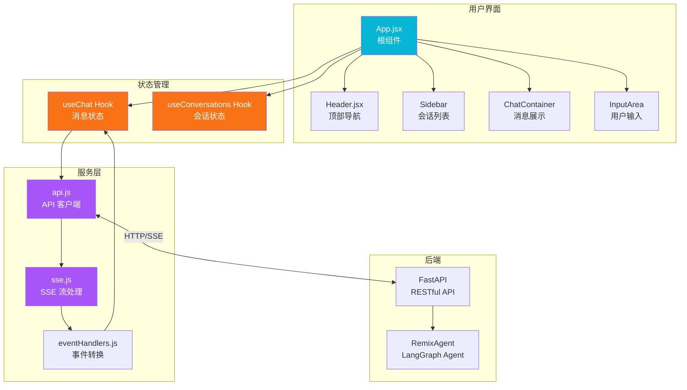
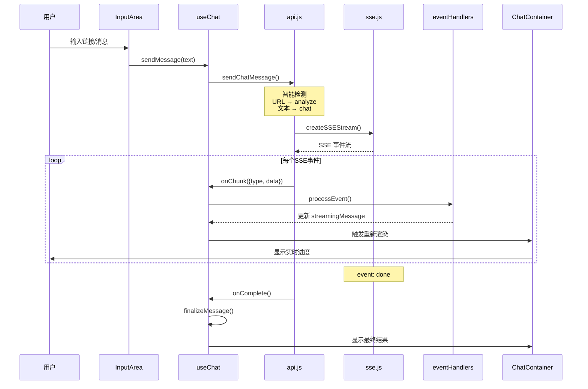
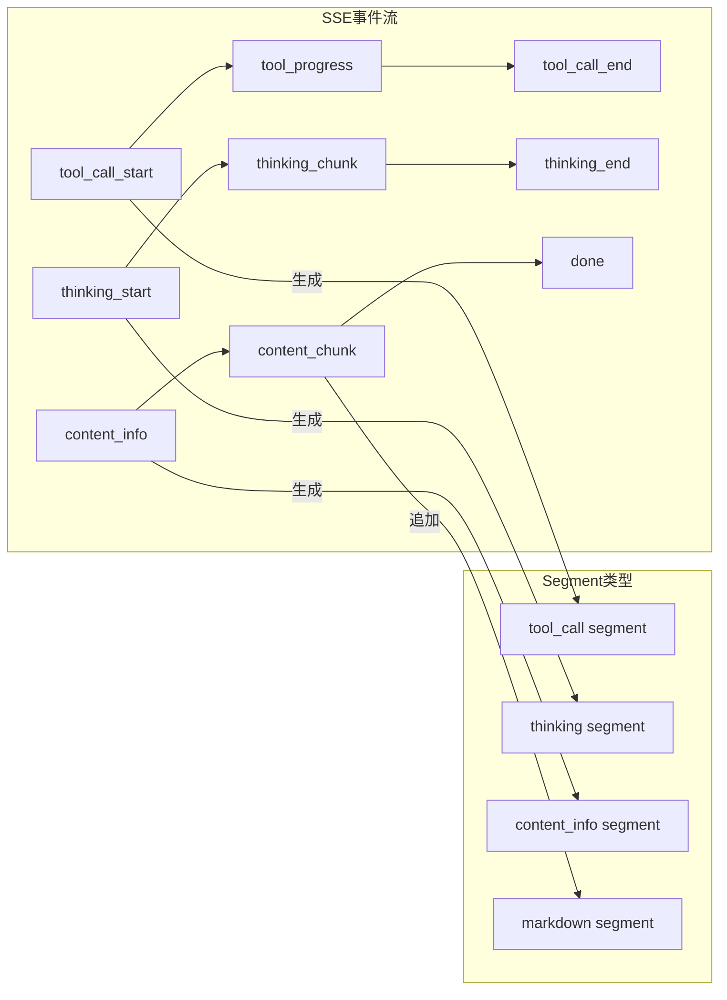
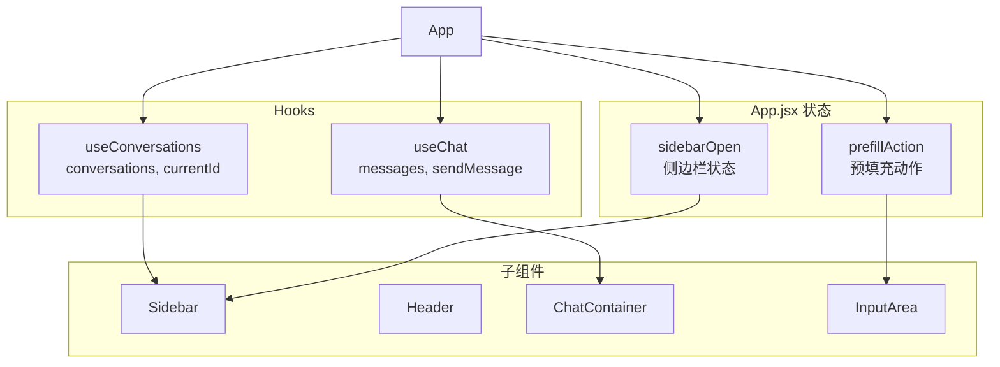
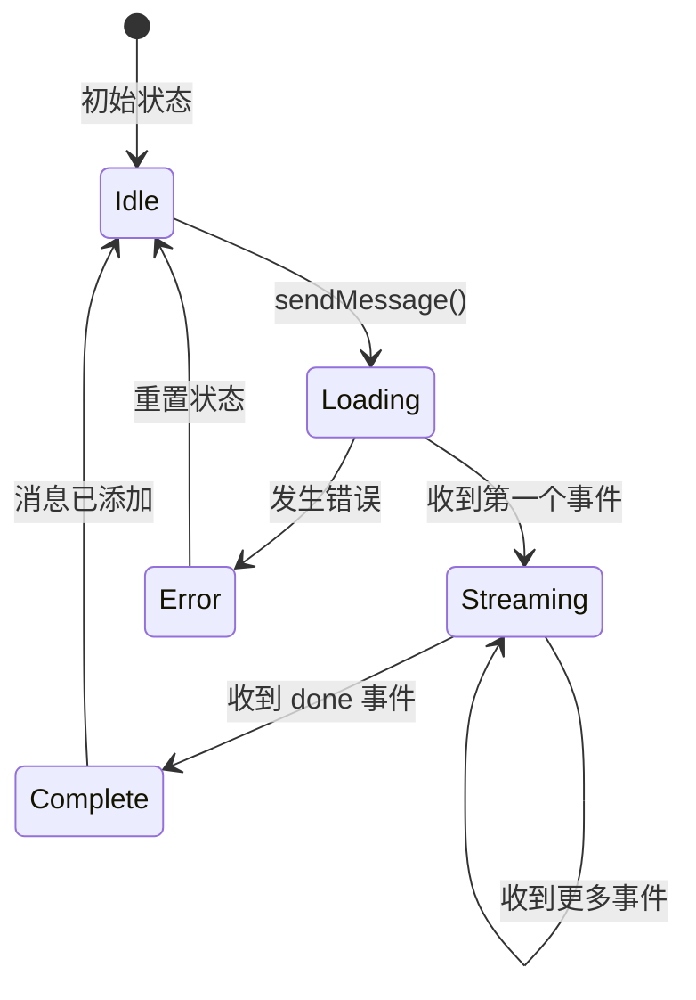
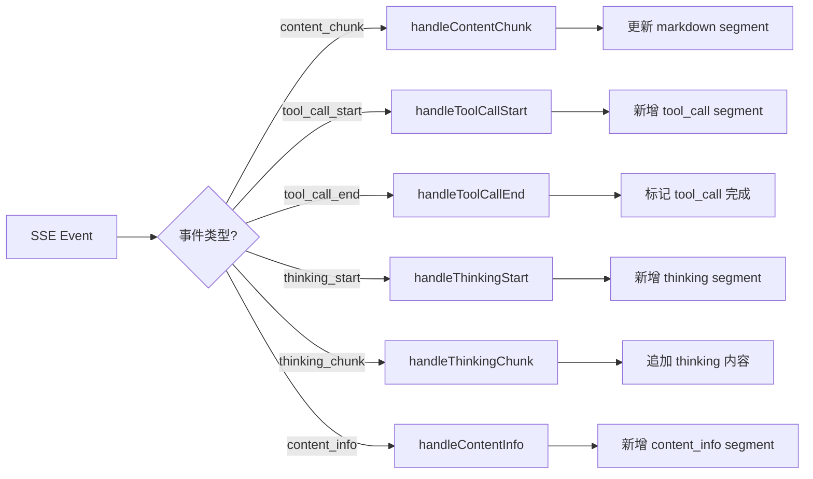
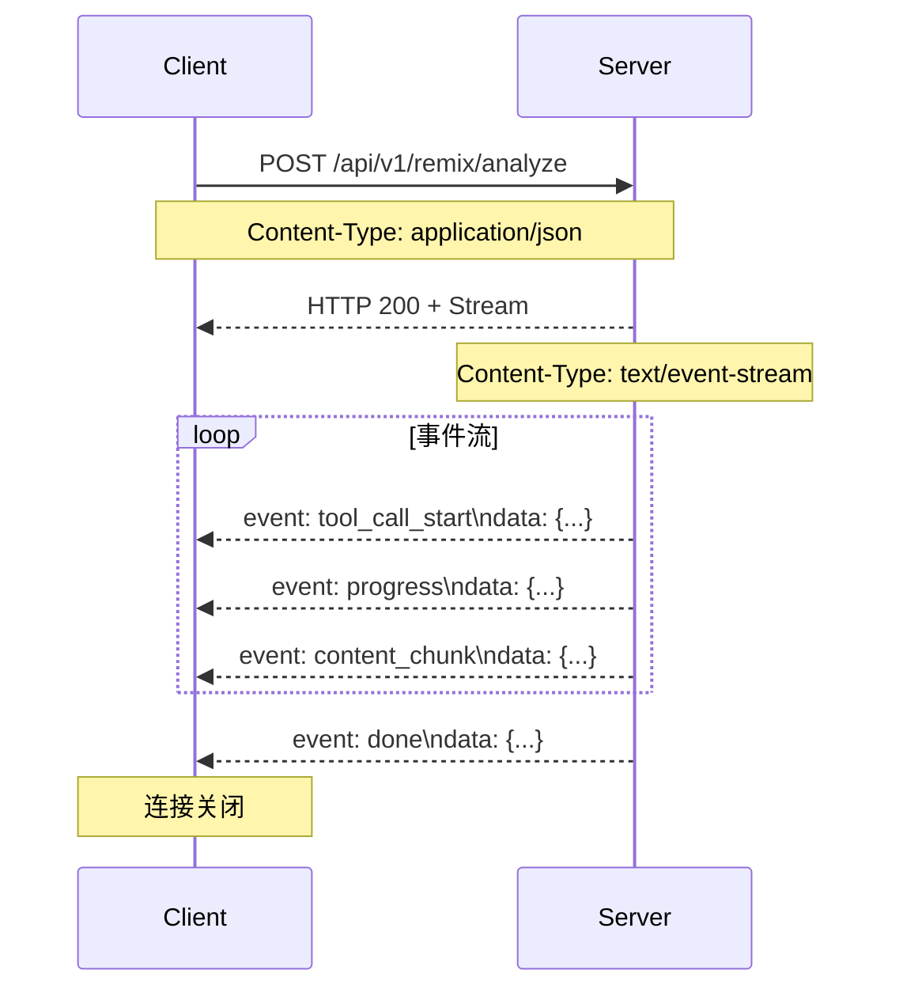
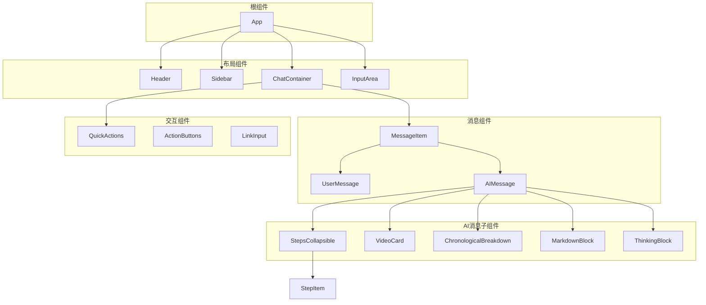
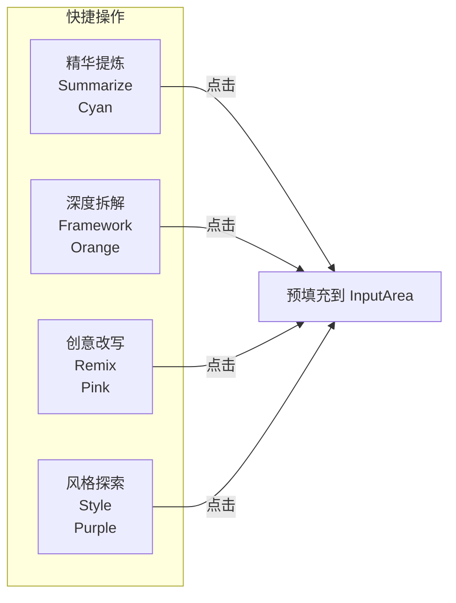
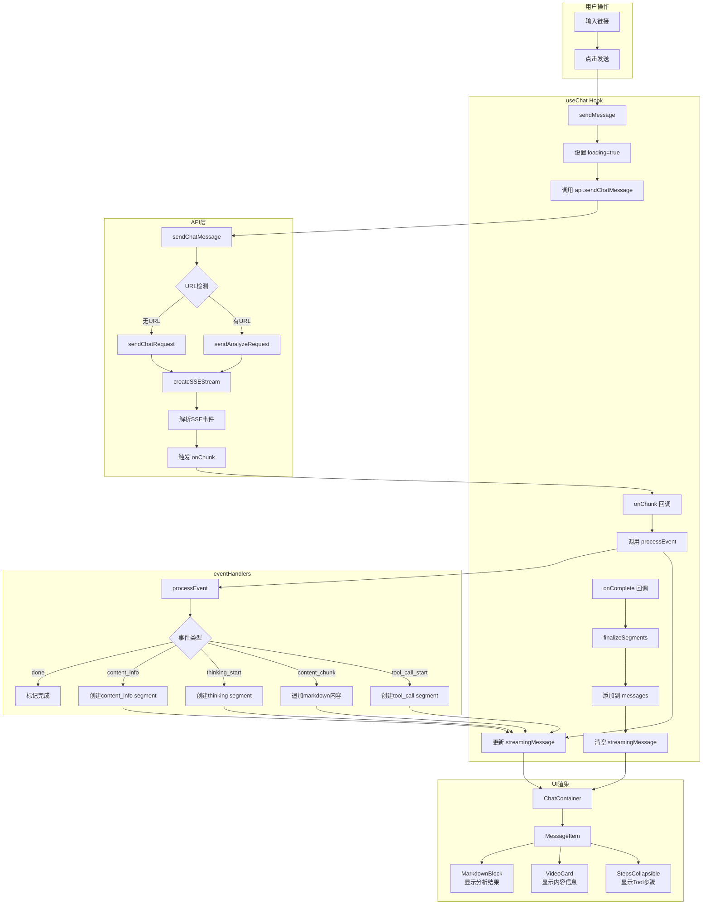

# Content Remix Agent 前端源代码指南

> 本文档帮助项目初学者快速理解前端代码结构、模块职责和调用流程。

## 目录

- [项目概述](#项目概述)
- [技术栈](#技术栈)
- [目录结构](#目录结构)
- [核心架构](#核心架构)
- [数据流详解](#数据流详解)
- [模块详解](#模块详解)
  - [入口文件](#入口文件)
  - [Hooks 模块](#hooks-模块)
  - [Services 模块](#services-模块)
  - [Components 组件](#components-组件)
  - [Constants 常量](#constants-常量)
  - [Utils 工具函数](#utils-工具函数)
- [组件层级关系](#组件层级关系)
- [SSE 事件处理流程](#sse-事件处理流程)
- [样式系统](#样式系统)
- [开发指南](#开发指南)

---

## 项目概述

Content Remix Agent 是一个 **AI 驱动的内容二次创作助手**，帮助内容创作者分析、学习爆款内容的创作技巧。

**核心功能：**
- 支持多平台内容解析（小红书、抖音、B站、快手）
- 四种学习模式：精华提炼、深度拆解、模板学习、风格探索
- 实时流式输出分析结果
- 对话式交互，支持追问调整

---

## 技术栈

| 类别 | 技术 | 版本 |
|------|------|------|
| 框架 | React | 19.2.0 |
| 构建工具 | Vite | 7.2.4 |
| 样式 | Tailwind CSS | 4.1.18 |
| 图标 | Lucide React | - |
| Markdown | react-markdown + remark-gfm | - |
| 代码质量 | ESLint | 9.39.1 |

---

## 目录结构

```
frontend/src/
├── App.jsx                    # 根组件（主布局控制器）
├── main.jsx                   # React 入口
├── index.css                  # 设计系统 & 全局样式
├── App.css                    # App 特定样式
│
├── components/                # UI 组件库 (31个文件)
│   ├── Header.jsx            # 顶部导航栏
│   ├── Sidebar/              # 侧边栏（会话列表）
│   ├── ChatContainer.jsx     # 聊天消息区
│   ├── InputArea.jsx         # 底部输入框
│   ├── MessageItem.jsx       # 消息渲染器
│   ├── QuickActions.jsx      # 快捷操作按钮
│   ├── VideoCard.jsx         # 内容预览卡片
│   ├── StepsCollapsible.jsx  # 可折叠步骤列表
│   ├── MarkdownBlock.jsx     # Markdown 渲染
│   └── ...                   # 更多组件
│
├── hooks/                     # 自定义 Hooks
│   ├── useChat.js            # 聊天状态管理
│   ├── useConversations.js   # 会话列表管理
│   └── chat/
│       └── eventHandlers.js  # SSE 事件处理
│
├── services/                  # API 服务层
│   ├── api.js                # REST API + 智能路由
│   └── sse.js                # SSE 流处理
│
├── constants/                 # 常量定义
│   └── tools.js              # Tool 映射配置
│
└── utils/                     # 工具函数
    └── formatters.js         # 格式化函数
```

---

## 核心架构

### 整体架构图



### 数据流向



---

## 数据流详解

### 消息对象结构

```javascript
// Message 对象
{
  id: "msg_1705000000000_abc123",    // 唯一ID
  role: "user" | "assistant",        // 角色
  content: string,                   // 文本内容
  segments: [                        // 分段内容（用于渲染）
    { type: "markdown", content: "分析报告..." },
    { type: "tool_call", tool: "fetch_content", status: "completed" },
    { type: "thinking", content: "让我分析一下...", status: "completed" },
    { type: "content_info", data: { title, cover, author... } }
  ],
  timestamp: 1705000000000,
  isComplete: boolean,
  structuredData: {                  // 结构化数据
    content_info: {...},
    transcript: {...},
    analysis: {...},
    copywriting: {...}
  }
}
```

### SSE 事件类型



| 事件类型 | 触发时机 | 生成的 Segment |
|---------|---------|---------------|
| `tool_call_start` | Tool 开始执行 | `tool_call` (running) |
| `tool_progress` | Tool 执行进度 | 更新 `tool_call.progress` |
| `tool_call_end` | Tool 执行完成 | `tool_call` (completed) |
| `thinking_start` | AI 开始思考 | `thinking` (running) |
| `thinking_chunk` | 思考内容流 | 追加到 `thinking.content` |
| `thinking_end` | 思考结束 | `thinking` (completed) |
| `content_info` | 内容元数据 | `content_info` |
| `content_chunk` | 文本内容流 | 追加到 `markdown.content` |
| `done` | 处理完成 | 标记 `isComplete=true` |

---

## 模块详解

### 入口文件

#### `main.jsx`
React 19 应用入口，使用 `createRoot` 渲染。

```javascript
import { createRoot } from 'react-dom/client'
import App from './App.jsx'
import './index.css'

createRoot(document.getElementById('root')).render(<App />)
```

#### `App.jsx`
根组件，负责：
- 管理侧边栏展开/折叠状态
- 整合 `useChat` 和 `useConversations` 两个核心 Hook
- 协调消息发送和会话切换



---

### Hooks 模块

#### `useChat.js` - 聊天状态管理

**职责：** 管理消息列表、流式消息、会话 ID



**核心状态：**
```javascript
{
  messages: Message[],           // 历史消息列表
  streamingMessage: Message,     // 当前流式消息（正在生成）
  loading: boolean,              // 是否加载中
  sessionId: string | null       // 当前会话 ID
}
```

**核心方法：**
| 方法 | 说明 |
|------|------|
| `sendMessage(text, attachments)` | 发送消息，触发 SSE 流 |
| `clearMessages()` | 清空消息列表 |
| `setSessionId(id)` | 切换会话 ID |

#### `useConversations.js` - 会话列表管理

**职责：** 管理会话历史、搜索、CRUD 操作

```javascript
{
  conversations: Conversation[],  // 会话列表
  currentId: string | null,       // 当前会话 ID
  searchQuery: string,            // 搜索关键词
  loading: boolean
}
```

**核心方法：**
| 方法 | 说明 |
|------|------|
| `createConversation()` | 新建会话（清空 currentId） |
| `selectConversation(id)` | 选择会话 |
| `deleteConversation(id)` | 删除会话 |
| `loadConversations()` | 从 API 加载列表 |

#### `eventHandlers.js` - SSE 事件处理

**职责：** 将 SSE 事件转换为 Segment 更新



---

### Services 模块

#### `api.js` - API 客户端

**智能路由逻辑：**

```mermaid
graph TB
    A[sendChatMessage] --> B{检测输入}
    B -->|包含URL| C{有 sessionId?}
    B -->|纯文本| D[sendChatRequest]
    C -->|无| E[sendAnalyzeRequest]
    C -->|有| F[提取指令]
    F --> E

    E -->|POST| G[/api/v1/remix/analyze]
    D -->|POST| H[/api/v1/remix/chat]
```

**URL 检测规则：**
```javascript
const URL_PATTERNS = [
  /https?:\/\/[^\s]+/,           // 标准 URL
  /v\.douyin\.com\/[^\s]+/,      // 抖音短链
  /xhslink\.com\/[^\s]+/,        // 小红书短链
  /b23\.tv\/[^\s]+/              // B站短链
]
```

**核心函数：**
| 函数 | 说明 |
|------|------|
| `sendAnalyzeRequest(url, options, callbacks)` | 分析新链接 |
| `sendChatRequest(message, sessionId, callbacks)` | 对话追问 |
| `sendChatMessage(message, token, options, callbacks)` | 智能路由（自动选择） |
| `fetchSessions(limit, offset)` | 获取会话列表 |
| `getSessionMessages(sessionId)` | 获取历史消息 |
| `deleteSession(sessionId)` | 删除会话 |

#### `sse.js` - SSE 流处理

**职责：** 封装 SSE 连接和事件解析



**核心函数：**
```javascript
// 创建 SSE 流
createSSEStream(url, body, { onChunk, onError, onComplete })

// 带取消功能的版本
createCancellableSSEStream(url, body, callbacks)
// 返回 { promise, abort }
```

---

### Components 组件

#### 组件层级关系



#### 核心组件说明

| 组件 | 文件 | 职责 |
|------|------|------|
| **ChatContainer** | `ChatContainer.jsx` | 消息列表容器，管理滚动和空状态 |
| **InputArea** | `InputArea.jsx` | 输入框，支持预填充和智能粘贴 |
| **MessageItem** | `MessageItem.jsx` | 消息渲染器，区分用户/AI消息 |
| **QuickActions** | `QuickActions.jsx` | 四个快捷操作按钮 |
| **VideoCard** | `VideoCard.jsx` | 内容预览卡片（封面、标题、数据） |
| **StepsCollapsible** | `StepsCollapsible.jsx` | 可折叠的 Tool 执行步骤 |
| **MarkdownBlock** | `MarkdownBlock.jsx` | Markdown 渲染组件 |

#### QuickActions 四个模式



---

### Constants 常量

#### `tools.js` - Tool 配置

```javascript
// Tool 信息映射
const TOOLS = {
  parse_link: {
    icon: Link,
    label: "提取笔记链接",
    completedLabel: "已提取笔记链接"
  },
  fetch_content: {
    icon: Download,
    label: "解析链接",
    completedLabel: "已解析链接"
  },
  process_video: {
    icon: Mic,
    label: "获取原始内容",
    completedLabel: "已获取原始内容"
  },
  analyze_content: {
    icon: FileSearch,
    label: "结构拆解生成",
    completedLabel: "结构拆解已完成"
  },
  generate_copywriting: {
    icon: PenTool,
    label: "生成文案",
    completedLabel: "文案已生成"
  }
}

// 阶段到 Tool 的映射
const STAGE_TO_TOOL = {
  parsing: "parse_link",
  fetching: "fetch_content",
  downloading: "process_video",
  transcribing: "process_video",
  analyzing: "analyze_content",
  generating: "generate_copywriting"
}
```

---

### Utils 工具函数

#### `formatters.js`

| 函数 | 说明 | 示例 |
|------|------|------|
| `formatDuration(seconds)` | 格式化时长 | `65` → `"1m5s"` |
| `formatShortDuration(seconds)` | 短格式时长 | `65` → `"~1m5s"` |
| `generateMessageId()` | 生成消息ID | `"msg_1705000000000_abc123"` |
| `truncateText(text, max)` | 截断文本 | `"hello..."` |

---

## SSE 事件处理流程

### 完整处理流程图



---

## 样式系统

### Tailwind 主题配置

```css
/* index.css */
@theme {
  /* 背景色 */
  --color-bg-primary: #0f172a;     /* 主背景 */
  --color-bg-secondary: #1e293b;   /* 卡片背景 */
  --color-bg-tertiary: #334155;    /* 悬停状态 */

  /* 强调色 */
  --color-accent-cyan: #06b6d4;    /* 主操作色 */
  --color-accent-orange: #f97316;  /* 次要操作 */
  --color-accent-pink: #ec4899;    /* 创意模式 */
  --color-accent-purple: #a855f7;  /* 探索模式 */

  /* 文字色 */
  --color-text-primary: #f8fafc;   /* 主文字 */
  --color-text-secondary: #94a3b8; /* 次要文字 */
  --color-text-muted: #64748b;     /* 弱化文字 */
}
```

### 常用样式类

| 类名 | 说明 |
|------|------|
| `.card` | 基础卡片样式 |
| `.card-glow` | 发光卡片 |
| `.btn-primary` | 主要按钮 |
| `.btn-ghost` | 幽灵按钮 |
| `.badge` | 标签 |
| `.custom-scrollbar` | 自定义滚动条 |

---

## 开发指南

### 启动项目

```bash
# 安装依赖
cd content_remix_agent/frontend
npm install

# 启动开发服务器 (默认 http://localhost:5173)
npm run dev

# 生产构建
npm run build

# 代码检查
npm run lint
```

### 配置代理

`vite.config.js` 已配置 API 代理：

```javascript
server: {
  proxy: {
    '/api': {
      target: 'http://localhost:8001',  // 后端地址
      changeOrigin: true
    }
  }
}
```

### 添加新组件

1. 在 `src/components/` 创建组件文件
2. 使用 `React.memo()` 优化性能
3. 使用 Lucide 图标的 ESM 导入方式：
   ```javascript
   import { Link } from 'lucide-react/dist/esm/icons/link'
   ```

### 添加新的 SSE 事件类型

1. 在 `eventHandlers.js` 添加处理函数：
   ```javascript
   export function handleNewEvent(data, currentState) {
     // 返回新的 state
   }
   ```

2. 在 `processEvent` 中添加分支：
   ```javascript
   case 'new_event_type':
     return handleNewEvent(data, currentState)
   ```

### 添加新的 Tool 类型

在 `constants/tools.js` 添加配置：

```javascript
TOOLS.new_tool = {
  icon: SomeIcon,
  label: "新工具",
  completedLabel: "新工具已完成"
}

STAGE_TO_TOOL.new_stage = "new_tool"
```

---

## 调试技巧

### 查看 SSE 事件

在浏览器 DevTools → Network → 筛选 `EventStream`，可以看到原始 SSE 事件。

### 查看状态变化

在 `useChat.js` 中添加日志：

```javascript
useEffect(() => {
  console.log('Messages updated:', messages)
}, [messages])

useEffect(() => {
  console.log('Streaming:', streamingMessage)
}, [streamingMessage])
```

### 模拟 SSE 事件

```javascript
// 在 console 中测试 eventHandlers
import { processEvent } from './hooks/chat/eventHandlers'

const mockState = { segments: [] }
const newState = processEvent('content_chunk', { content: 'Hello' }, mockState)
```

---

## 常见问题

### Q: 为什么消息没有自动滚动？

检查 `ChatContainer.jsx` 中的 `scrollToBottom` 是否被正确调用。

### Q: SSE 连接断开怎么办？

检查后端服务是否正常运行，以及 Vite 代理配置是否正确。

### Q: 大模型配置在哪里设置？

在左侧边栏底部的「设置」入口进入 **大模型配置**，可新增/编辑/删除并激活配置。
后端优先读取数据库中 `is_active=1` 的配置，未配置时才回退 `.env`。

### Q: 如何添加新的学习模式？

1. 在 `QuickActions.jsx` 添加新按钮
2. 在 `api.js` 的 `extractModeFromMessage` 中添加模式识别
3. 后端添加对应的处理逻辑

---

## 参考文档

- [React 19 文档](https://react.dev/)
- [Vite 文档](https://vitejs.dev/)
- [Tailwind CSS 文档](https://tailwindcss.com/)
- [Lucide Icons](https://lucide.dev/)
- [技术架构文档](../architecture/technical_architecture.md)
- [Agent 组件与交互](../architecture/agent_components.md)
- [部署指南](../deployment/deployment_guide.md)
