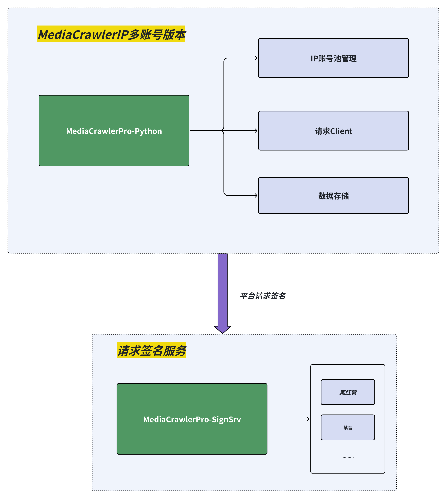

## 免责声明

本仓库的所有内容仅供学习使用，禁止用于商业用途。任何人或组织不得将本仓库的内容用于非法用途或侵犯他人合法权益。

我们提供的爬虫仅能获取抖音、快手、哔哩哔哩、小红书、百度贴吧、微博平台上**公开的信息**，

我们强烈反对任何形式的隐私侵犯行为。如果你使用本项目进行了侵犯他人隐私的行为，我们将与你保持距离，并支持受害者通过法律手段维护自己的权益。<br>

对于因使用本仓库内容而引起的任何法律责任，本仓库不承担任何责任。使用本仓库的内容即表示您同意本免责声明的所有条款和条件<br>

点击查看更为详细的免责声明。[点击跳转](#disclaimer)

🤖 **AI Agent 用户？** 支持 OpenClaw 🦞 / Claude Code / Cursor 一键安装 Skill，让 Agent 自动爬取数据 → [查看 Skill 安装](#ai-agent-skill-安装openclaw---claude-code)

## Pro版本使用教程
> 在安装部署之前，请务必 [查看Pro的一些注意事项汇总](https://github.com/MediaCrawlerPro/MediaCrawlerPro-Python/issues/336)

视频部署教程： [B站：MediaCrawlerPro使用教程](https://space.bilibili.com/434377496/channel/series)

### 本地部署
> Python 依赖推荐统一使用 uv：进入对应子项目执行 `uv sync` 即可，uv 会按项目配置自动准备 Python 环境和依赖。
>
> 相关依赖：nodejs（版本大于16），redis 在开始之前请确保你的电脑上已经安装了这些依赖。具体方法请自行谷歌或者百度。
>
> 数据库支持：MySQL 或 SQLite（二选一）。如果不想安装 MySQL，可以使用 SQLite 本地存储，零依赖开箱即用。
> 
> 最新安装python依赖@2025-05-27
> 安装好 uv 之后先执行 `uv sync`，再使用 `uv run main.py xxx` 来替代 `python main.py xxx`。


#### 1、新建Pro版本目录（再次提醒相关的依赖需要先安装）
```shell
# 新建目录MediaCrawlerPro并进入
mkdir MediaCrawlerPro
cd MediaCrawlerPro
```

##### 2、克隆签名服务仓库并安装依赖
```shell
# 先克隆签名服务仓库并安装依赖
git clone https://github.com/MediaCrawlerPro/MediaCrawlerPro-SignSrv
cd MediaCrawlerPro-SignSrv

# 使用 uv 安装依赖
uv sync 
```

##### 3、启动签名服务
本地安装签名服务时，需要nodejs环境，版本大于等于16以上
```shell
python app.py 
```

##### 4、克隆主项目仓库并安装依赖
```shell
# 再克隆主项目仓库
git clone https://github.com/MediaCrawlerPro/MediaCrawlerPro-Python.git

# 进入项目目录
cd MediaCrawlerPro-Python

# 使用 uv 安装依赖
uv sync 
```
##### 5、配置账号池+IP代理信息
> 多账号管理基于cookies+IP配对，请按下方的配置说明进行配置，否则会导致爬虫无法正常运行。

Pro版本强烈推荐`IP代理+账号池`，代码层面基于这两者做了大量的重试机制来保障爬虫的稳定性。
配置文档见：[配置说明](config/README.md)

##### 5.1、（可选）使用 CookieBridge 自动同步 Cookie

> 如果你觉得手动从浏览器复制 Cookie 到 Excel/MySQL 太麻烦，可以使用 **CookieBridge** 来自动同步。

CookieBridge 是一个 Chrome Extension + Server 的组合，安装到浏览器后会自动提取各平台的 Cookie 并通过 WebSocket 实时同步到 Server。爬虫通过 HTTP API 获取 Cookie，无需手动操作。

**优势对比：**

| | 传统方式（手动 Excel/MySQL） | CookieBridge（自动同步） |
|---|---|---|
| Cookie 获取 | 手动用 Cookie-Editor 插件复制粘贴 | 浏览器登录后自动同步，零手动操作 |
| Cookie 过期 | 需要重新手动提取 | 浏览器在线时自动保持最新 |
| 多账号 | Excel 不同行 / 数据库不同记录 | 不同 Chrome Profile 自动区分 |
| 登录状态 | 无法感知 | 实时检测，Popup 面板可视化 |

**部署步骤：**

```bash
# 1. 克隆 CookieBridge 仓库
cd MediaCrawlerPro
git clone https://github.com/MediaCrawlerPro/MediaCrawlerPro-CookieBridge

# 2. 启动 CookieBridge Server
cd MediaCrawlerPro-CookieBridge/server
uv sync
uv run app.py
# Server 运行在 http://localhost:8274

# 3. 安装 Chrome Extension
# Chrome 地址栏输入 chrome://extensions/ → 开启右上角「开发者模式」
# → 点击「加载已解压的扩展程序」→ 选择 MediaCrawlerPro-CookieBridge/extension/ 目录

# 4. 验证连接
curl http://localhost:8274/api/status
# 应该能看到已连接的客户端

# 5. 获取 Cookie（HTTP API）
curl http://localhost:8274/api/cookies/xhs
```

多账号场景：在不同 Chrome Profile 中安装 Extension，每个 Profile 登录不同账号，CookieBridge 会自动为每个 Profile 分配独立的 `client_id`。

详细文档见：[CookieBridge 使用文档](../MediaCrawlerPro-CookieBridge/README.md)

##### 6、配置数据存储方式
强力推荐使用数据库存储数据，使用`db存储`，代码层面有判断重复机制，如果是json和csv则没有。<br>
详细的介绍参见：[配置说明](config/README.md)

**新增 SQLite 本地存储支持**：如果不想安装 MySQL，只需在 `config/db_config.py` 中将 `DB_TYPE` 改为 `"sqlite"` 即可使用本地 SQLite 数据库，无需额外安装任何数据库服务。首次运行会自动建表。<br>
详细的技术文档参见：[SQLite本地存储技术文档](docs/7.SQLite本地存储技术文档.md)

```python
# config/db_config.py 中修改以下配置
DB_TYPE = "sqlite"                           # 改为 sqlite
SQLITE_DB_PATH = "./media_crawler.db"        # SQLite 数据库文件路径，可自定义

# 或者通过环境变量设置
# export DB_TYPE=sqlite
# export SQLITE_DB_PATH=./media_crawler.db
```


> **⚠️ Cookie 是爬虫运行的前置条件**
>
> 没有有效的 Cookie，爬虫会报错：*"账号池中没有可用的账号"*。请确保在启动爬虫前已完成 Cookie 配置：
>
> | 方案 | 适用场景 | 5分钟快速开始 |
> |------|---------|-------------|
> | **CookieBridge**（推荐） | 自动化、省心 | 步骤 5.1 装好 → 浏览器登录平台 → 自动同步 |
> | **Excel** | 快速测试 | [Cookie-Editor 插件](https://chromewebstore.google.com/detail/cookie-editor/hlkenndednhfkekhgcdicdfddnkalmdm) 复制 → 粘贴到 `config/accounts_cookies.xlsx` |
> | **MySQL** | 生产环境 | 写入 `crawler_cookies_account` 表 |
>
> **平台特殊要求**：微博必须用 H5 版（m.weibo.cn）Cookie；知乎必须在搜索结果页获取 Cookie。

##### 6、启动主项目进行爬虫
搜索关键词以及其他的信息还是跟MediaCrawler的配置一样，在`config/base_config.py`中配置即可。

```shell
# 查看命令具体用法
uv run main.py --help 

# 启动爬虫
uv run main.py --platform xhs --type search

# 原生方式启动
python main.py --platform xhs --type search
```
🌿🌿 新增断点续爬功能，使用文档见：[断点续爬系统文档](docs/断点续爬系统文档.md)

##### 7、查看数据
> 不再推荐你使用csv和json存储，存储效率慢，还做不到排重，使用数据库（MySQL/SQLite）存数据非常方便和高效

- **MySQL**: 数据存储在数据库中，可以通过数据库客户端（如 Navicat、DBeaver）查看数据。
- **SQLite**: 数据存储在本地 `.db` 文件中（默认 `./media_crawler.db`），可以使用 [DB Browser for SQLite](https://sqlitebrowser.org/) 或 DBeaver 等工具查看数据。


## AI Agent Skill 安装（OpenClaw 🦞 / Claude Code）
> 安装skill前，强力建议自己先自己手动安装一下MediaCrawlerPro，确保它可以正常运行。熟悉下整个流程，方便后续精准的跟ai agent进行交互。

MediaCrawlerPro 支持以 **Skill** 的形式安装到 AI Coding Agent 中，让 Agent 具备自媒体数据爬取能力。

支持的 Agent 平台：
- **[OpenClaw](https://openclaw.ai/) 🦞** — 一键安装 Skill
- **Claude Code** — 复制到 `~/.claude/skills/` 目录
- **Cursor / Windsurf** — 复制到项目规则目录

> 详细文档见：[Skill 安装文档](docs/9.Skill安装文档.md)

### 快速安装（复制以下提示词发送给你的 AI Agent）
> 前置条件：你AI Agent所在的电脑需配置自己的github账号，不然是访问不了安装文档的，这一步成功之后它才能访问下面的安装文档

```
帮我安装 MediaCrawlerPro Skill。按照 https://github.com/MediaCrawlerPro/MediaCrawlerPro-Python/blob/main/docs/9.Skill安装文档.md 文档操作：
1. 把 .claude/skills/media-crawler-pro/ 目录（含 references/）复制到你的 skills 目录下
2. 克隆以下四个仓库到同一个父目录：MediaCrawlerPro-Python、MediaCrawlerPro-SignSrv、MediaCrawlerPro-Downloader、MediaCrawlerPro-CookieBridge
3. 安装各子项目的 Python 依赖（用 uv）
4. 不需要启动服务，后续使用时按需启动

备注：请先确保用户本地的github账号已经配置好，否则无法访问到MediaCrawlerPro安装文档。因为Pro这个组织里的所有代码仓库都是私有代码，只有被邀请进组织的成员才能访问。
可以使用gh等cli工具来查看 https://github.com/MediaCrawlerPro/MediaCrawlerPro-Python 这个repo的权限来判断
```

安装完成后，你可以直接对 Agent 说：
- "搜索小红书上关于 AI 的笔记"
- "帮我下载这个抖音视频" + URL
- "获取这个B站UP主的信息" + URL

Agent 会自动启动服务、运行爬虫、返回结果。

## 仓库调用关系

### MediaCrawlerPro-Python + MediaCrawlerPro-SignSrv

> 拿xhs举例：在发起xhs平台某一个API请求前，我们需要一个x-s参数生成，原来在MediaCrawler中这部分逻辑是通过playwright去调用xhs它的window对象下的加密函数，然后生成x-s参数，
> 这部分逻辑是耦合在MediaCrawler中的，并且强制依赖playwright。

把请求签名的逻辑从原MediaCrawler中抽出去，做成一个单的服务（MediaCrawlerPro-SignSrv）还有好处就是：
后续如果主爬虫端不是python，而是换了一门语言，例如golang实现，我们也能很好的支持。 这就是解耦的好处，在软件工程中，解耦是一个很重要的概念，解耦后的代码更加灵活，更加容易维护。

调用关系图：
<div>
    
</div>

### MediaCrawlerPro-CookieBridge（可选）

CookieBridge 是第三个可选的子服务，用于**自动同步浏览器 Cookie**，替代手动复制粘贴到 Excel/MySQL 的操作。

```
                                        ┌─ Chrome Profile A (Extension) ─┐
                                        │  账号: 小红薯用户A             │
                                        └───── WebSocket ────────────────┘
                                                    │
MediaCrawlerPro-Python ── HTTP API ──> CookieBridge Server (:8274)
  (获取Cookie)                                      │
                                        ┌───── WebSocket ────────────────┐
                                        │  Chrome Profile B (Extension)  │
                                        │  账号: 小红薯用户B             │
                                        └────────────────────────────────┘
```

**三个服务协同工作：**

| 服务 | 端口 | 作用 | 是否必须 |
|------|------|------|---------|
| MediaCrawlerPro-SignSrv | 8888 | 请求签名（x-s 等参数生成） | 必须 |
| MediaCrawlerPro-CookieBridge | 8274 | Cookie 自动同步 | 可选（可用 Excel/MySQL 替代） |
| MediaCrawlerPro-Python | - | 主爬虫程序 | 必须 |

启动顺序：SignSrv → CookieBridge（可选）→ Python 主爬虫

## 项目文件目录结构
[点击查看](project_tree.md)


## 免责声明
<div id="disclaimer"> 

### 1. 项目目的与性质
本项目（以下简称“本项目”）是作为一个技术研究与学习工具而创建的，旨在探索和学习网络数据采集技术。本项目专注于自媒体平台的数据爬取技术研究，旨在提供给学习者和研究者作为技术交流之用。

### 2. 法律合规性声明
本项目开发者（以下简称“开发者”）郑重提醒用户在下载、安装和使用本项目时，严格遵守中华人民共和国相关法律法规，包括但不限于《中华人民共和国网络安全法》、《中华人民共和国反间谍法》等所有适用的国家法律和政策。用户应自行承担一切因使用本项目而可能引起的法律责任。

### 3. 使用目的限制
本项目严禁用于任何非法目的或非学习、非研究的商业行为。本项目不得用于任何形式的非法侵入他人计算机系统，不得用于任何侵犯他人知识产权或其他合法权益的行为。用户应保证其使用本项目的目的纯属个人学习和技术研究，不得用于任何形式的非法活动。

### 4. 免责声明
开发者已尽最大努力确保本项目的正当性及安全性，但不对用户使用本项目可能引起的任何形式的直接或间接损失承担责任。包括但不限于由于使用本项目而导致的任何数据丢失、设备损坏、法律诉讼等。

### 5. 知识产权声明
本项目的知识产权归开发者所有。本项目受到著作权法和国际著作权条约以及其他知识产权法律和条约的保护。用户在遵守本声明及相关法律法规的前提下，可以下载和使用本项目。

### 6. 最终解释权
关于本项目的最终解释权归开发者所有。开发者保留随时更改或更新本免责声明的权利，恕不另行通知。
</div>
