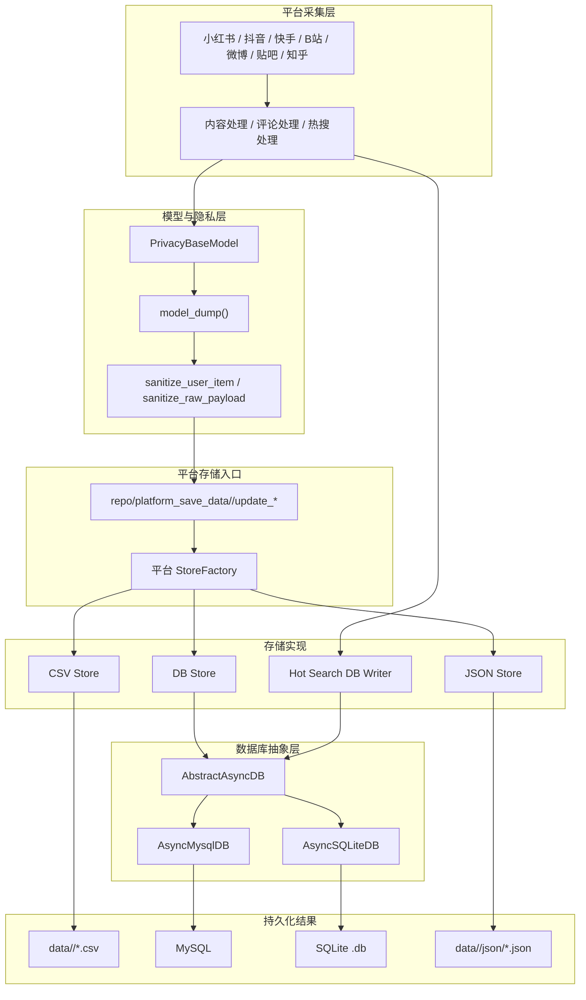
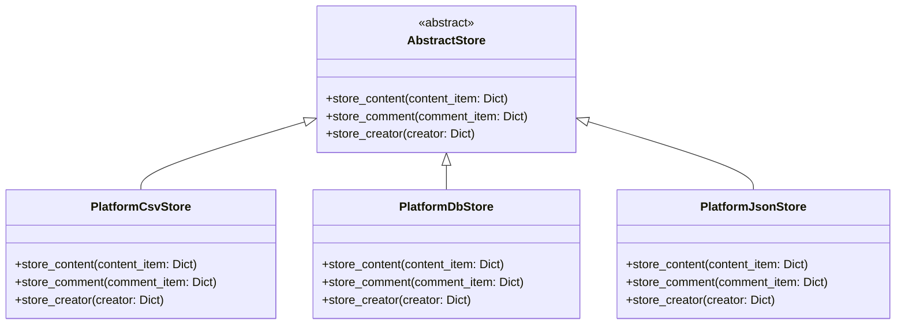
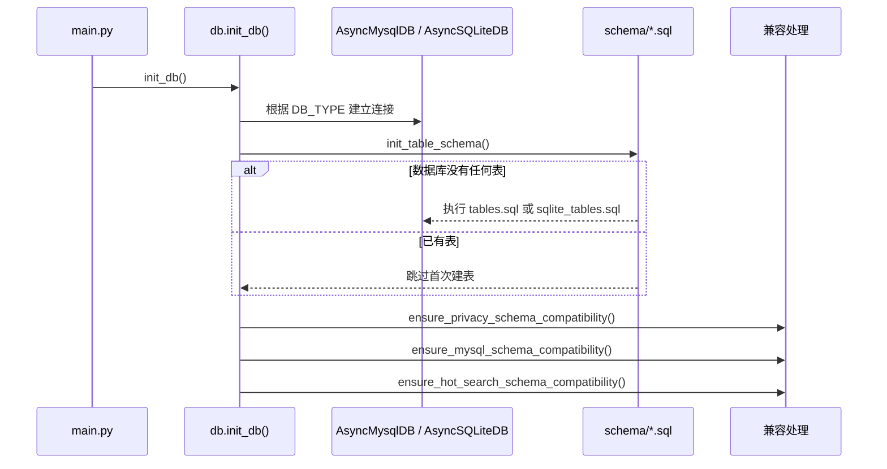
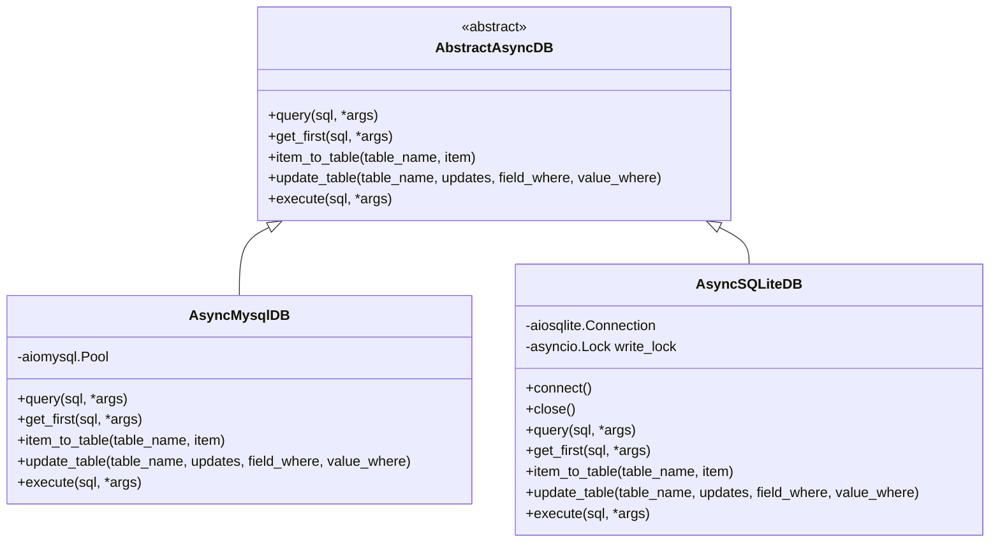

# 4. 平台存储系统深度解析

## 重要声明

**MediaCrawlerPro-Python 仅供个人学习和源码研究使用，并不是爬虫服务。** 使用者应严格遵守目标平台的使用条款、robots.txt、合理频率限制和项目根目录下的 [LICENSE](../LICENSE)。

当前存储层遵循数据最小化原则：内容、评论和热搜结果只保留学习分析需要的公开内容字段与统计字段，不保存可直接定位或联系用户的原始身份信息。昵称可以保留，但必须脱敏；原始用户 ID、sec_uid、头像、主页链接、IP location 等字段不进入新的持久化结构。

---

## 1. 存储目标

平台数据存储层负责把各平台采集到的内容、评论和热搜快照落到本地文件或数据库中。它的边界很明确：

- 内容数据：笔记、视频、微博、贴吧帖子、知乎内容等。
- 评论数据：一级评论和二级评论统一通过评论表或评论文件保存。
- 热搜数据：只在数据库存储模式下写入跨平台热搜表。
- 账号池数据：`crawler_cookies_account` 只服务于采集账号/cookies 管理，不属于被采集用户资料。
- 创作者资料：新的表结构不再创建 creator profile 表，平台入口也不再持久化创作者主页信息。

## 2. 总体架构

### 2.1 数据流



### 2.2 配置关系

内容/评论/热搜的存储方式由 `SAVE_DATA_OPTION` 决定：

| 配置 | 说明 |
|------|------|
| `SAVE_DATA_OPTION=csv` | 写入 `data/<platform>/*.csv`，适合快速查看。 |
| `SAVE_DATA_OPTION=db` | 写入数据库。数据库后端再由 `DB_TYPE` 选择 MySQL 或 SQLite。 |
| `SAVE_DATA_OPTION=json` | 写入 `data/<platform>/json/*.json`，适合本地结构化检查。 |

数据库后端由 `DB_TYPE` 决定：

| 配置 | 说明 |
|------|------|
| `DB_TYPE=mysql` | 默认值，使用 `RELATION_DB_*` 连接 MySQL。 |
| `DB_TYPE=sqlite` | 使用 `SQLITE_DB_PATH` 指向的本地 `.db` 文件。 |

`ACCOUNT_POOL_SAVE_TYPE` 是账号池/cookies 来源配置，支持 `xlsx`、`mysql`、`cookie_bridge`。它和 `SAVE_DATA_OPTION` 是两条独立配置线，不代表内容数据的存储方式。其中 `mysql` 是历史配置名；当 `DB_TYPE=sqlite` 时，账号池 SQL 读写也会走当前 SQLite 连接里的 `crawler_cookies_account` 表。

## 3. 存储抽象

### 3.1 平台 StoreFactory

每个平台都有独立的 `StoreFactory`，但结构一致：

| 平台 | 工厂类 | 目录 |
|------|--------|------|
| 小红书 | `XhsStoreFactory` | `repo/platform_save_data/xhs` |
| 抖音 | `DouyinStoreFactory` | `repo/platform_save_data/douyin` |
| 快手 | `KuaishouStoreFactory` | `repo/platform_save_data/kuaishou` |
| B站 | `BiliStoreFactory` | `repo/platform_save_data/bilibili` |
| 微博 | `WeibostoreFactory` | `repo/platform_save_data/weibo` |
| 贴吧 | `TieBaStoreFactory` | `repo/platform_save_data/tieba` |
| 知乎 | `ZhihuStoreFactory` | `repo/platform_save_data/zhihu` |

工厂只根据 `config.SAVE_DATA_OPTION` 选择 `csv`、`db`、`json` 三类实现。当前平台内容存储层没有 MongoDB 或 Redis 后端；Redis 只属于缓存/代理池相关能力，不是平台内容存储后端。

### 3.2 AbstractStore 接口



`store_creator()` 仍保留在抽象接口上，主要是为了兼容历史结构和各平台已有类定义。当前高层 `save_creator()` / `update_*creator()` 入口直接返回，DB 版 creator 存储也直接返回；新的 schema 不再创建 creator profile 表。

## 4. 隐私与脱敏边界

### 4.1 持久化字段原则

新的内容表和评论表保留：

- `creator_hash`：匿名创作者哈希，用于同一来源用户的弱关联分析。
- `nickname` 或 `user_nickname`：脱敏昵称。
- 内容字段：标题、正文、链接、图片列表、视频地址、发布时间、互动统计、来源关键词等。
- 评论字段：评论 ID、内容 ID、评论内容、发布时间、父评论 ID、点赞数等。

新的内容表和评论表不保存：

- 原始用户 ID：`user_id`、`sec_uid`、`uid`、`mid`、`author_id` 等。
- 用户主页或可追踪链接：`profile_url`、`user_link`、`user_url_token`、`url_token` 等。
- 用户资料：头像、签名、性别、个人简介等。
- 位置字段：`ip_location`、`ip_address` 等。

### 4.2 脱敏实现

`pkg/tools/user_privacy.py` 是隐私处理的核心：

- `PrivacyBaseModel`：平台模型的基类，在输入校验和 `model_dump()` 时清理用户字段。
- `sanitize_user_item()`：生成 `creator_hash`、脱敏昵称、删除禁止持久化的用户字段。
- `sanitize_raw_payload()`：清理嵌套原始 JSON，避免热搜或 checkpoint 里的原始 payload 带入用户资料。
- `anonymize_user_id()`：对来源用户标识做 SHA256，并截取前 16 位作为匿名哈希。
- `mask_nickname()`：保留昵称首尾可读性，中间以星号替代；过短昵称也会脱敏。

DB 写入层还会在 `AbstractAsyncDB.item_to_table()` 和 `update_table()` 再调用一次 `sanitize_user_item()`。这意味着即使某个平台忘了在模型层清理，SQL 边界也会再次兜底。

### 4.3 空 `creator_hash` 的含义

`creator_hash` 只会从可用的用户来源标识计算。若当前平台返回数据里没有可用来源 ID，或旧数据已经丢失了原始 ID，就不会为了凑字段而使用昵称反推哈希，此时 `creator_hash` 允许为空字符串。这样可以避免把脱敏昵称误当成稳定身份标识。

## 5. DB 存储：MySQL 与 SQLite

### 5.1 初始化流程



首次初始化时：

- MySQL 使用 `schema/tables.sql`。
- SQLite 使用 `schema/sqlite_tables.sql`。
- `init_table_schema()` 只在数据库完全没有表时执行 schema 文件；已有表时会跳过。

注意：schema 文件包含 `DROP TABLE IF EXISTS`，它们是新库初始化脚本，不建议对已有业务数据的库手动执行。已有库应通过正常启动流程走兼容逻辑。

### 5.2 数据库抽象层



MySQL 使用 `aiomysql` 连接池。SQLite 使用单个 `aiosqlite` 连接，开启 WAL 模式，并用进程内 `asyncio.Lock` 串行化写操作；读操作不经过写锁。SQLite 适合本地学习、小规模验证和低并发写入，不应把它理解成跨进程高并发写入方案。

### 5.3 插入与更新

各平台 DB store 的逻辑基本一致：

1. 根据内容 ID 或评论 ID 查询是否已有记录。
2. 不存在则补 `add_ts` 并插入。
3. 已存在则移除 `add_ts`，只更新业务字段和 `last_modify_ts`。
4. 真正写入时再由 `AbstractAsyncDB` 做一次隐私清理和 SQL 执行。

这是一种查询后插入/更新的去重方式。表上多数是普通索引，不能把它理解成完全依赖唯一键约束的 upsert。

### 5.4 旧库兼容

为了不破坏老用户已有库，启动时会做非破坏式兼容处理：

- 老内容表或评论表如果缺少 `creator_hash`，会新增该列。
- 如果老表还保留原始用户 ID 列，会先用这些列回填 `creator_hash`，再把原始值改成 `redacted_*`。
- 老表已有昵称会原地改为脱敏昵称。
- 头像、主页链接、IP location、签名等历史隐私列会被清空，但列本身保留，避免破坏用户旧表结构。
- 老 creator profile 表会被保留并清理字段；新库不会再创建这些表。
- MySQL 老库还会补两个历史字段兼容：`douyin_aweme.title` 升级为 `TEXT`，`xhs_note_comment.pictures` 升级为 `LONGTEXT`。

后续写入旧表时，如果旧表仍有 NOT NULL 的用户身份列，写入层会填入 `redacted_*` 或空字符串占位，确保兼容旧 schema，同时不再保存原始用户资料。

## 6. 文件存储：CSV 与 JSON

### 6.1 CSV

CSV 文件保存到：

```text
data/<platform>/<file_count>_<crawler_type>_<store_type>_<date>.csv
```

例如：

```text
data/bilibili/1_search_contents_20260703.csv
data/xhs/1_search_comments_20260703.csv
```

写入前会执行 `sanitize_user_item()`。CSV 适合快速查看和小规模导出，但没有数据库级查询和去重能力。

### 6.2 JSON

JSON 文件保存到：

```text
data/<platform>/json/<crawler_type>_<store_type>_<date>.json
```

JSON store 使用 `asyncio.Lock` 避免同进程并发写同一文件时互相覆盖。写入前同样会执行 `sanitize_user_item()`，输出是脱敏后的扁平模型数据，而不是原始平台响应的嵌套用户对象。

### 6.3 示例记录

```json
{
  "note_id": "example_note",
  "title": "示例标题",
  "desc": "示例正文",
  "nickname": "张***三",
  "creator_hash": "16位匿名哈希",
  "liked_count": "10",
  "comment_count": "2",
  "source_keyword": "python",
  "last_modify_ts": 1782111427549
}
```

示例里的 `creator_hash` 不是用户 ID，也不能反推出平台原始用户标识。

## 7. 表结构速查

### 7.1 内容与评论表

| 平台 | 内容表 | 内容主 ID | 评论表 | 评论主 ID | 脱敏昵称字段 |
|------|--------|-----------|--------|-----------|--------------|
| 小红书 | `xhs_note` | `note_id` | `xhs_note_comment` | `comment_id` | `nickname` |
| 抖音 | `douyin_aweme` | `aweme_id` | `douyin_aweme_comment` | `comment_id` | `nickname` |
| 快手 | `kuaishou_video` | `video_id` | `kuaishou_video_comment` | `comment_id` | `nickname` |
| B站 | `bilibili_video` | `video_id` | `bilibili_video_comment` | `comment_id` | `nickname` |
| 微博 | `weibo_note` | `note_id` | `weibo_note_comment` | `comment_id` | `nickname` |
| 贴吧 | `tieba_note` | `note_id` | `tieba_comment` | `comment_id` | `user_nickname` |
| 知乎 | `zhihu_content` | `content_id` | `zhihu_comment` | `comment_id` | `user_nickname` |

这些内容表和评论表都包含 `creator_hash`，用于匿名关联；新 schema 不包含原始用户 ID、头像、IP location 或用户主页字段。

### 7.2 通用表

| 表名 | 用途 | 写入条件 |
|------|------|----------|
| `crawler_cookies_account` | 账号池 cookies 管理 | `ACCOUNT_POOL_SAVE_TYPE=mysql` 时通过当前 DB 连接读取/更新；MySQL 和 SQLite schema 都提供同名表结构。 |
| `platform_hot_search_item` | 跨平台热搜榜单项快照 | `SAVE_DATA_OPTION=db` 且热搜采集流程写入。 |
| `platform_hot_search_content_rel` | 热搜项与内容表记录的关系 | `SAVE_DATA_OPTION=db` 且热搜项关联到内容 ID 时写入。 |

## 8. 热搜存储

热搜存储不走各平台 `AbstractStore`，而是走 `repo/platform_save_data/hot_search` 的共享写入逻辑。


当前实现了微博、抖音、知乎、B站、快手的热搜 item builder。小红书和贴吧如后续接入热搜，只需要补对应 builder 和平台调用，不需要新增通用热搜表。

`raw_json` 保存的是清理后的平台原始榜单项 JSON，嵌套用户对象、头像、主页链接、IP location 等字段会被移除。

## 9. 新增平台或存储后端

新增一个平台时，建议保持以下顺序：

1. 定义平台模型，并继承 `PrivacyBaseModel`。
2. 在 `repo/platform_save_data/<platform>/__init__.py` 提供 `StoreFactory` 和 `update_*` 入口。
3. 实现 CSV、DB、JSON 三个 Store 类，至少保证内容和评论可写。
4. 在 `schema/tables.sql` 和 `schema/sqlite_tables.sql` 同步添加内容表与评论表。
5. 只保存 `creator_hash` 和脱敏昵称，不新增原始用户身份字段。
6. 补充旧库兼容逻辑，而不是要求老用户手动删除表或字段。
7. 加入针对 MySQL/SQLite、CSV/JSON 隐私清理的测试。

新增一个真正的内容存储后端时，才需要扩展各平台 `StoreFactory.STORES`。如果只是给爬虫运行时做缓存、代理池或 checkpoint，不应混入平台内容存储架构。

## 10. 使用建议

- 本地学习和首次试用：推荐 `SAVE_DATA_OPTION=db DB_TYPE=sqlite`，少依赖，容易查看。
- 已有 MySQL 环境或需要多任务查询：使用 `SAVE_DATA_OPTION=db DB_TYPE=mysql`。
- 临时导出：使用 `csv` 或 `json`，但要理解它们不是数据库，不提供跨运行去重。
- 旧库升级前先备份，正常启动应用让兼容逻辑处理旧字段，不要对有数据的库直接执行 schema 文件。
- 如果看到旧表仍有历史用户字段，重点检查字段值是否已变成 `redacted_*` 或空字符串；字段保留本身是兼容老库的设计，不代表新数据还会继续保存原始用户信息。
